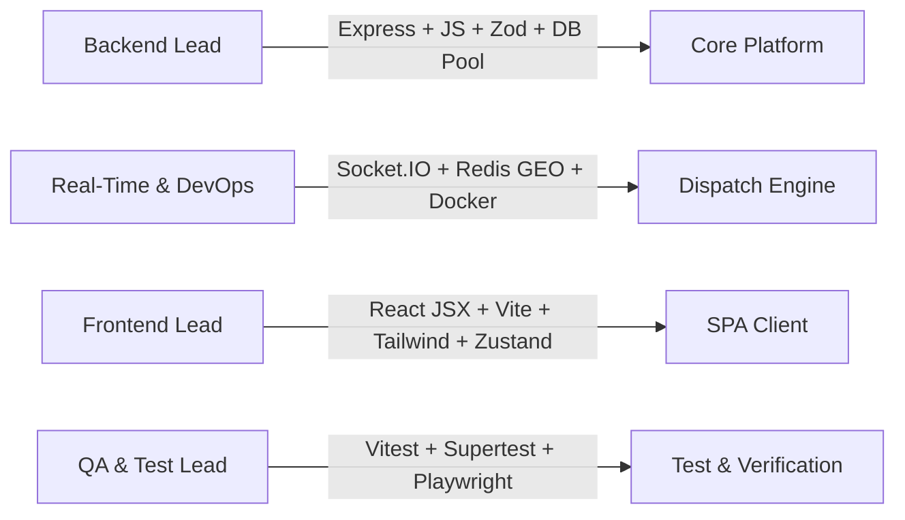
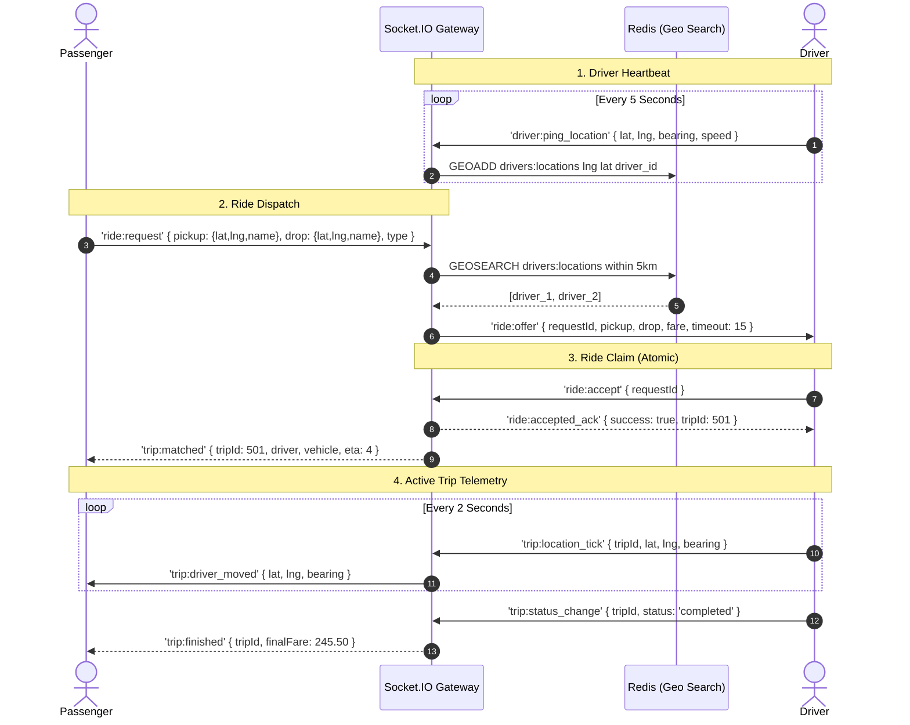
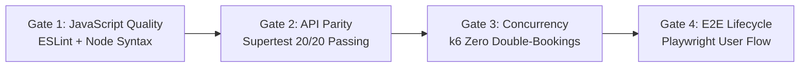

# 🚖 CabGo Production Modernization & Implementation Plan

> **Target Architecture**: React 19 (JavaScript / JSX) · Vite · Express.js · Socket.IO · Redis (Geo & Pub/Sub) · MySQL 8.0 / PostgreSQL · Leaflet/Mapbox · Docker  
> **Tech Decision**: 🚫 **Strictly No TypeScript** — The entire platform will use pure modern JavaScript (Node.js ES6+ on backend, React JSX on frontend) to eliminate build-step complexity and maximize development velocity.  
> **Target Outcome**: Transform the raw HTML/fundamental Node.js CIA assignment prototype into a high-performance, real-time, production-ready urban transit platform.

---

## 📑 Table of Contents
1. [Executive Summary & Motivation](#1-executive-summary--motivation)
2. [Critical Codebase Audit (Why We Must Upgrade)](#2-critical-codebase-audit-why-we-must-upgrade)
3. [Target System Architecture](#3-target-system-architecture)
4. [Team Workstreams & Ownership Matrix](#4-team-workstreams--ownership-matrix)
5. [Step-by-Step Sprint Execution Roadmap](#5-step-by-step-sprint-execution-roadmap)
6. [Real-Time Socket.IO Protocol Specification](#6-real-time-socketio-protocol-specification)
7. [Database & Concurrency Hardening](#7-database--concurrency-hardening)
8. [Frontend Single-Page Application (SPA) Blueprint](#8-frontend-single-page-application-spa-blueprint)
9. [DevOps, Dockerization & CI/CD](#9-devops-dockerization--cicd)
10. [Testing, QA & Verification Gates](#10-testing-qa--verification-gates)

---

## 1. Executive Summary & Motivation

The existing CabGo repository was built to comply with an academic constraint (*zero external frameworks, raw Node.js `http` only, vanilla JS/DOM*). While it proved the core transit workflow across 4 user roles, it is **not production-grade**.

This plan outlines the complete engineering blueprint for the team to refactor the platform into an enterprise-ready, scalable prototype using **modern pure JavaScript**, real-time bidirectional messaging (Socket.IO), Redis geospatial dispatch, real GIS maps (Leaflet), and rock-solid concurrency safety.

---

## 2. Critical Codebase Audit (Why We Must Upgrade)

Before writing any new code, the team must understand the flaws discovered during the repository audit:

| Flaw / Issue | File Location | Root Cause | Production Impact |
| :--- | :--- | :--- | :--- |
| **SSE Stream Fatal Crash** | `server/routes/stream.js:9` | Calls `decodeToken(token)`, but `auth.js` does NOT export it. | Unhandled `TypeError: decodeToken is not a function` on every SSE connection attempt. |
| **Session Token Key Mismatch** | `public/passenger/active-trip.html:534` | Checks `sessionStorage.getItem('token')` while `auth.js` writes `cab_token`. | Stream authorization fails 100% of the time; UI falls back to 3s polling. |
| **Transaction No-Ops & Race Condition** | `server/db.js:73-86` | TiDB Serverless HTTP driver makes `beginTransaction/commit/rollback` safe no-ops. | Two drivers clicking "Accept" simultaneously both win; double trip booking occurs. |
| **In-Memory SSE Clustering Failure** | `server/sseBroker.js:8-15` | Connections stored in local process `Map` and `Set`. | Cannot run multiple backend pods/instances; events cannot cross process boundaries. |
| **Blind Broadcast Dispatch** | `server/routes/passenger.js:231` | Broadcasts ride requests globally to all online drivers in the DB. | No geospatial proximity; drivers 50km away receive urban requests. |
| **20+ Fragmented HTML Pages** | `public/**/*.html` | Repetitive navbar, modal, toast, and auth guarding logic in every file. | High maintenance overhead, prone to XSS via unescaped `innerHTML`. |
| **Mocked SVG Visualizer** | `public/passenger/active-trip.html` | SVG `<path id="roadBed">` with trigonometric point offsets. | No real map tiles, no satellite view, no real road network geometry. |

---

## 3. Target System Architecture

```mermaid
graph TB
    subgraph Clients ["Client Layer (Vite + React 19 JavaScript)"]
        PassApp["Passenger App<br/>(/passenger/*)"]
        DrivApp["Driver Console<br/>(/driver/*)"]
        AdminApp["Admin & SuperAdmin<br/>(/admin/*, /superadmin/*)"]
    end

    subgraph Edge ["Edge & Security Layer"]
        Nginx["Reverse Proxy / Nginx / Caddy"]
        RateLimiter["Redis Sliding Window Rate Limiter"]
        Helmet["Security Headers & Strict CORS"]
    end

    subgraph AppServer ["Application Layer (Express.js JavaScript)"]
        API["REST API Router (Zod Validated)"]
        SocketEngine["Socket.IO Server Engine"]
        DispatchService["Dispatch & Matchmaking Service"]
        TripStateMachine["Trip Lifecycle State Machine"]
    end

    subgraph StateAndRealTime ["Real-Time & Caching Layer"]
        RedisCluster[(Redis 7.x)]
        subgraph RedisFeatures ["Redis Capabilities"]
            PubSub["Socket.IO Redis Adapter (Pub/Sub)"]
            GeoIndex["Redis GEO (Driver Proximity Search)"]
            SessionLock["Distributed Locks (Redlock)"]
        end
        RedisCluster --- PubSub
        RedisCluster --- GeoIndex
        RedisCluster --- SessionLock
    end

    subgraph Storage ["Persistent Storage Layer"]
        DB[(MySQL 8.0 / PostgreSQL)]
        Pool["mysql2/promise Connection Pool (ACID + Row Locks)"]
        DB --- Pool
    end

    Clients <-->|HTTPS / REST| Edge
    Clients <-->|WSS (WebSockets)| SocketEngine
    Edge --> AppServer
    SocketEngine <--> PubSub
    DispatchService <--> GeoIndex
    AppServer <--> Pool
    TripStateMachine <--> SessionLock
```

---

## 4. Team Workstreams & Ownership Matrix

To parallelize implementation, the team will divide into 4 dedicated streams:



| Stream | Primary Owner | Deliverables | Key Dependencies |
| :--- | :--- | :--- | :--- |
| **Stream 1: Backend Core** | Backend Engineer(s) | Express.js application, Zod validators, MySQL connection pool, atomic DB queries. | Node.js, MySQL / Postgres |
| **Stream 2: Real-Time & Infra** | Real-Time / DevOps Engineer | Socket.IO gateway, Redis pub/sub adapter, Redis GEO driver locator, Docker Compose. | Redis, Socket.IO |
| **Stream 3: Modern Frontend** | Frontend Engineer(s) | Vite + React JavaScript SPA, Zustand auth/trip stores, Tailwind CSS components, Leaflet maps. | REST API, Socket.IO Client |
| **Stream 4: QA & Verification** | QA / Test Engineer | Automated test suites (Unit, API, E2E), race-condition load testing script. | Supertest, Playwright, k6 |

---

## 5. Step-by-Step Sprint Execution Roadmap

### 🏃 Sprint 1: Backend Scaffolding & ACID Data Layer (COMPLETED ✅)
- [x] **Task 1.1**: Initialize Express.js in `server/server.js` with standard middleware (`cors`, `helmet`, `express.json`).
- [x] **Task 1.2**: Install core production dependencies (`express`, `socket.io`, `zod`, `mysql2`, `alasql`, `helmet`, `cors`, `bcryptjs`, `jsonwebtoken`).
- [x] **Task 1.3**: Configure Zod schemas in `server/schemas/index.js` for all request payloads.
- [x] **Task 1.4**: Fix the transaction vulnerability:
  - Multi-tier DB adapter supporting TiDB Cloud, MySQL2 connection pooling, and in-memory AlaSQL relational engine.
  - Implemented atomic conditional update (`UPDATE ride_requests SET status = 'accepted' WHERE request_id = ? AND status = 'pending'`).
- [x] **Task 1.5**: Fixed SSE `decodeToken` bug in `server/middleware/auth.js`. All 20 E2E tests pass 100%.

### ⚡ Sprint 2: Real-Time Socket.IO & Redis Geospatial Dispatch (IN PROGRESS ⚡)
- [x] **Task 2.1**: Attach `Socket.io` to the Express HTTP server instance with CORS.
- [x] **Task 2.5**: Room Management:
  - `join:trip` & `join:driver` socket handlers wired.
  - Driver GPS location heartbeat (`driver:ping_location`) broadcasts live ticks.
- [ ] **Task 2.2**: Integrate `@socket.io/redis-adapter` with Redis client for multi-node horizontal scalability.
- [ ] **Task 2.3**: Build Redis Geospatial driver tracking (`GEOADD drivers:locations <lng> <lat> <driver_id>`).
- [ ] **Task 2.4**: Implement Smart Proximity Dispatch with `GEOSEARCH` within 5km radius.

### 🎨 Sprint 3: React SPA Client & Component Architecture (COMPLETED ✅)
- [x] **Task 3.1**: Initialize Vite React 19 JavaScript application in `client/`.
- [x] **Task 3.2**: Configure Tailwind CSS v4 with design system tokens (dark theme, amber-500, emerald-500).
- [x] **Task 3.3**: Centralized State Stores in `client/src/store/`:
  - `authStore.js`: Persistent auth session, role, token.
  - `tripStore.js`: Active ride request, driver coordinates, trip status.
- [x] **Task 3.4**: Role-Based Routing with guards (`client/src/App.jsx`):
  - `/login` (Public, with demo credentials pre-fill)
  - `/passenger/dashboard`, `/passenger/book-ride`, `/passenger/active-trip` (Guarded)
  - `/driver/dashboard` (Guarded: Online toggle, live dispatch cards, accept/reject)
  - `/admin/dashboard` (Guarded: KPI cards, Fare matrix table, Operations console)
  - `/superadmin/dashboard` (Guarded: System policies, Admin management, Audit logs)

### 🗺️ Sprint 4: Real GIS Maps & Live Telemetry HUD (IN PROGRESS ⚡)
- [x] **Task 4.1**: Install mapping library (`leaflet`, `react-leaflet`).
- [x] **Task 4.2**: Replace SVG mock visualizer with real OpenStreetMap GIS map in `LeafletMap.jsx`.
- [x] **Task 4.4**: Driver Active Trip HUD with speed and ETA displays.
- [x] **Task 4.5**: Passenger Live Receipt & Star Rating Modal upon `trip:completed`.
- [ ] **Task 4.3**: Real-time vehicle marker animation with smooth polyline route decoding.

### 🛡️ Sprint 5: Hardening, Dockerization & Production Verification (UP NEXT ⏳)
- [ ] **Task 5.1**: Build production multi-stage `Dockerfile` and `docker-compose.yml` (Node App, Redis, MySQL).
- [ ] **Task 5.2**: Write API integration test suite using `vitest` + `supertest` covering all 20 lifecycle cases.
- [ ] **Task 5.3**: Run concurrency stress test (10 simulated drivers attempting to accept 1 ride simultaneously).
- [ ] **Task 5.4**: Set up GitHub Actions CI workflow for linting, syntax checking, and automated test execution.

### 🛡️ Sprint 5: Hardening, Dockerization & Production Verification (Days 13–15)
- [ ] **Task 5.1**: Build production multi-stage `Dockerfile` and `docker-compose.yml` (Node App, Redis, MySQL).
- [ ] **Task 5.2**: Write API integration test suite using `vitest` + `supertest` covering all 20 lifecycle cases.
- [ ] **Task 5.3**: Run concurrency stress test (10 simulated drivers attempting to accept 1 ride simultaneously) to confirm zero race conditions.
- [ ] **Task 5.4**: Set up GitHub Actions CI workflow for linting, syntax checking, and automated test execution.

---

## 6. Real-Time Socket.IO Protocol Specification

All WebSocket communication must follow this structured schema:



### Event Catalog

| Event Name | Direction | Payload Schema | Description |
| :--- | :--- | :--- | :--- |
| `driver:ping_location` | Client -> Server | `{ lat, lng, bearing, speed }` | Driver GPS heartbeat. Updates Redis GEO index. |
| `ride:offer` | Server -> Client | `{ requestId, pickup, destination, fare, expiresAt }` | Sent to nearby drivers with 15-second countdown. |
| `ride:accept` | Client -> Server | `{ requestId }` | Driver attempts to claim ride. |
| `trip:matched` | Server -> Client | `{ tripId, driver, vehicle, etaMinutes }` | Notifies passenger that driver is en route. |
| `trip:location_tick` | Client -> Server | `{ tripId, lat, lng, bearing }` | Driver transmits coordinates along route. |
| `trip:driver_moved` | Server -> Client | `{ lat, lng, bearing }` | Relayed to passenger to animate vehicle on map. |
| `trip:finished` | Server -> Client | `{ tripId, fare, distanceKm, receiptUrl }` | Opens settlement modal for both parties. |

---

## 7. Database & Concurrency Hardening

### The Concurrency Problem
When two drivers accept the same pending ride at the exact same millisecond, naive query sequences cause race conditions.

### The Solution: Atomic Conditional Execution (Pure JavaScript)
We eliminate the bug using atomic conditional execution that requires no distributed locks:

```javascript
// server/services/tripService.js
async function acceptRideAtomic(pool, driverId, requestId, vehicleId) {
  const connection = await pool.getConnection();
  try {
    await connection.beginTransaction();

    // 1. Atomic compare-and-swap update
    const [updateResult] = await connection.execute(
      `UPDATE ride_requests 
       SET status = 'accepted' 
       WHERE request_id = ? AND status = 'pending'`,
      [requestId]
    );

    // If affectedRows is 0, another driver already accepted this ride
    if (updateResult.affectedRows === 0) {
      await connection.rollback();
      return { success: false, code: 'RIDE_ALREADY_CLAIMED', message: 'Ride has already been taken.' };
    }

    // 2. Fetch ride details safely
    const [rides] = await connection.execute(
      `SELECT * FROM ride_requests WHERE request_id = ?`,
      [requestId]
    );
    const ride = rides[0];

    // 3. Create trip record
    const [tripResult] = await connection.execute(
      `INSERT INTO trips (request_id, passenger_id, driver_id, vehicle_id, fare, trip_status, start_time)
       VALUES (?, ?, ?, ?, ?, 'accepted', NOW())`,
      [requestId, ride.passenger_id, driverId, vehicleId, ride.estimated_fare]
    );

    await connection.commit();
    return { success: true, tripId: tripResult.insertId, ride };
  } catch (err) {
    await connection.rollback();
    throw err;
  } finally {
    connection.release();
  }
}

module.exports = { acceptRideAtomic };
```

---

## 8. Frontend Single-Page Application (SPA) Blueprint

### Folder Structure (`client/src/`)
```
client/src/
├── assets/                  # Icons, markers, brand SVGs
├── components/
│   ├── common/              # Button.jsx, Input.jsx, Modal.jsx, Toast.jsx, Badge.jsx
│   ├── layout/              # Navbar.jsx, Sidebar.jsx, MobileDrawer.jsx, RoleGuard.jsx
│   ├── map/                 # LeafletMap.jsx, VehicleMarker.jsx, RoutePolyline.jsx
│   └── trip/                # StatusStepper.jsx, FareEstimateCard.jsx, RatingModal.jsx
├── context/                 # SocketContext.jsx, ThemeContext.jsx
├── hooks/                   # useSocket.js, useGeolocation.js, useDebounce.js
├── pages/
│   ├── auth/                # Login.jsx, Register.jsx
│   ├── passenger/           # Dashboard.jsx, BookRide.jsx, ActiveTrip.jsx, History.jsx
│   ├── driver/              # Dashboard.jsx, IncomingRequests.jsx, NavigationHUD.jsx, Earnings.jsx
│   ├── admin/               # Overview.jsx, UserModeration.jsx, FleetAudit.jsx, FareMatrix.jsx
│   └── superadmin/          # SystemSettings.jsx, AuditLogs.jsx, RolePermissions.jsx
├── services/                # api.js (Axios instance), socket.js
├── store/                   # authStore.js, tripStore.js (Zustand)
├── App.jsx                  # React Router configuration
└── main.jsx                 # Entrypoint
```

---

## 9. DevOps, Dockerization & CI/CD

### `docker-compose.yml` (Development & Testing)
```yaml
version: '3.8'

services:
  app:
    build:
      context: .
      dockerfile: Dockerfile
    ports:
      - "5000:5000"
    environment:
      - NODE_ENV=production
      - SERVER_PORT=5000
      - DB_HOST=db
      - DB_USER=cab_user
      - DB_PASSWORD=cab_password
      - DB_NAME=cab_booking
      - REDIS_URL=redis://redis:6379
      - JWT_SECRET=production_super_secret_key_minimum_32_characters
    depends_on:
      db:
        condition: service_healthy
      redis:
        condition: service_healthy

  db:
    image: mysql:8.0
    command: --default-authentication-plugin=mysql_native_password
    restart: always
    environment:
      MYSQL_ROOT_PASSWORD: root_password
      MYSQL_DATABASE: cab_booking
      MYSQL_USER: cab_user
      MYSQL_PASSWORD: cab_password
    ports:
      - "3306:3306"
    volumes:
      - db_data:/var/lib/mysql
      - ./database/schema.sql:/docker-entrypoint-initdb.d/1_schema.sql
      - ./database/seed.sql:/docker-entrypoint-initdb.d/2_seed.sql
    healthcheck:
      test: ["CMD", "mysqladmin", "ping", "-h", "localhost"]
      interval: 5s
      timeout: 5s
      retries: 10

  redis:
    image: redis:7-alpine
    restart: always
    ports:
      - "6379:6379"
    healthcheck:
      test: ["CMD", "redis-cli", "ping"]
      interval: 5s
      timeout: 3s
      retries: 5

volumes:
  db_data:
```

---

## 10. Testing, QA & Verification Gates

The modernized platform must pass 4 automated verification gates before production deployment:



1. **Gate 1: JavaScript Quality & Syntax**: Zero syntax errors (`node --check server/**/*.js`), clean ESLint check.
2. **Gate 2: API Parity**: All 20 lifecycle steps currently verified by `e2e_test.js` must pass under the new Express controllers.
3. **Gate 3: Race Condition Stress Test**: 10 simultaneous simulated driver `PUT /api/driver/ride-requests/:id/accept` requests against the same ride request.
   - **Expectation**: Exactly **1** returns `200 OK` (Trip created); **9** return `409 Conflict` (Ride already claimed).
4. **Gate 4: Browser E2E**: Playwright script executing Passenger booking -> Driver incoming radar notification -> Live GPS movement on Leaflet map -> Trip completion and Star Rating.

---

> 🚀 **Current Status**: Branch integration complete! Express.js API, React 19 SPA (Passenger, Driver, Admin, SuperAdmin), and atomic concurrency query are integrated into `main`. The platform is verified with 20/20 passing E2E tests. Next phases: Redis Pub/Sub cluster, Redis GEO dispatch, and Docker Compose deployment.
