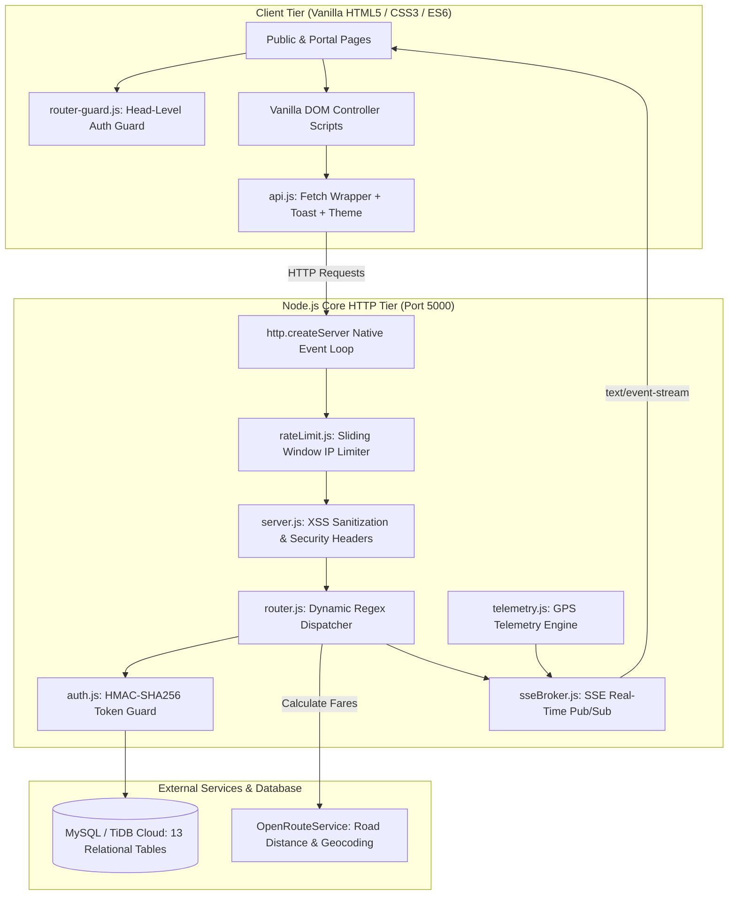
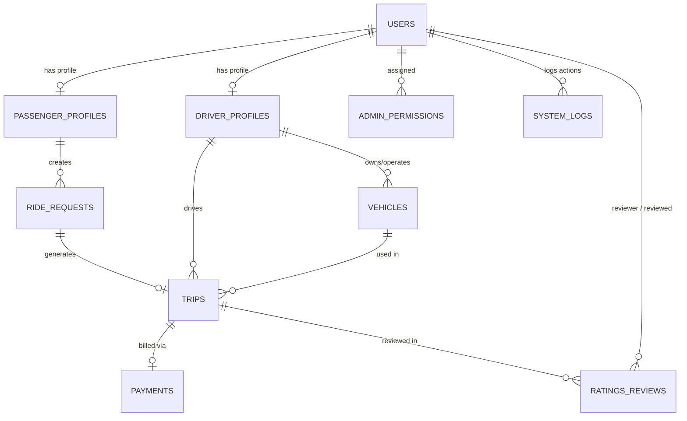

# 🚖 CabGo — Complete Project Evaluation & Viva Guide

> **Project Title**: CabGo — Multi-Tenant Online Cab Booking & Urban Transit Dispatch Platform  
> **Course / Context**: Web Technology CIA Project Evaluation  
> **Tech Stack**: HTML5 · Vanilla CSS3 · Vanilla JavaScript (ES6+ / DOM API / Fetch API) · Node.js (Built-in Modules Only) · MySQL / TiDB Cloud Serverless  
> **Core Constraint**: ❌ **Zero External Web Frameworks** (No Express.js, React, Vue, Angular, Socket.io, TailwindCSS, jsonwebtoken, or bcrypt).  

---

## 📑 Table of Contents
1. [Project Overview & Unique Value Proposition](#1-project-overview--unique-value-proposition)
2. [High-Level Architecture & Request Flow](#2-high-level-architecture--request-flow)
3. [Database Architecture & Schema Reference (13 Tables)](#3-database-architecture--schema-reference-13-tables)
4. [Zero-Dependency Security & Authentication Engine](#4-zero-dependency-security--authentication-engine)
5. [The Native Node.js Server & Routing Mechanism](#5-the-native-nodejs-server--routing-mechanism)
6. [Real-Time Streaming Engine (SSE & GPS Simulation)](#6-real-time-streaming-engine-sse--gps-simulation)
7. [Geocoding, Distance & Dynamic Fare Calculation](#7-geocoding-distance--dynamic-fare-calculation)
8. [End-to-End Portal Workflows (4 Portals)](#8-end-to-end-portal-workflows-4-portals)
9. [Frontend Engineering & UI Architecture](#9-frontend-engineering--ui-architecture)
10. [Complete Directory & Codebase File Map](#10-complete-directory--codebase-file-map)
11. [Pre-Seeded Test Credentials](#11-pre-seeded-test-credentials)
12. [5-Minute Live Demonstration Script](#12-5-minute-live-demonstration-script)
13. [Top 25 Viva & Evaluation Questions with Model Answers](#13-top-25-viva--evaluation-questions-with-model-answers)

---

## 1. Project Overview & Unique Value Proposition

**CabGo** is a full-featured, production-grade urban transit dispatch and cab booking web platform built entirely from first principles. 

While typical student and industry web projects rely heavily on bloated framework ecosystems (Express, React, Socket.io, etc.), CabGo demonstrates **deep mastery of core computing and web standards**:
- Built an **HTTP Request Router** with regex matching and parameter extraction (`:id`).
- Implemented **Cryptographic Session Tokens** (HMAC-SHA256) and **PBKDF2 Password Hashing** (10,000 iterations, SHA-512) without external packages.
- Built a **Server-Sent Events (SSE) Pub/Sub Broker** to stream real-time dispatch updates and vehicle GPS telemetry.
- Developed a **Single-Token Component Design System** in pure Vanilla CSS with dark/light mode and mobile navigation drawers.

### The 4 Multi-Tenant Portals:
| Role | Target User | Key Capabilities |
|---|---|---|
| **Passenger** | Commuter | Search rides, calculate real road fares, request cabs, track driver live via SSE GPS stream, settle payments, submit 5-star ratings. |
| **Driver** | Cab Partner | Toggle Online/Offline, receive real-time audio/visual dispatch alerts, accept/reject rides atomically, execute trips (Start $\rightarrow$ Complete), manage vehicles, track earnings. |
| **Admin** | Operations Manager | Verify driver documents, inspect vehicles, block/unblock accounts, override trip lifecycles, configure dynamic fare rules, review financial reports, export CSV data. |
| **Super Admin** | System Owner | Executive telemetry, manage sub-admins, configure granular RBAC permissions, update global platform policies (commission %, maintenance mode), review immutable system logs. |

---

## 2. High-Level Architecture & Request Flow



---

## 3. Database Architecture & Schema Reference (13 Tables)

The database is designed in **Third Normal Form (3NF)** with strict foreign key constraints, cascading deletions, and performance indexes.



### Table Breakdown

1. `users`
   - Primary Key: `user_id` (INT UNSIGNED AUTO_INCREMENT)
   - Columns: `name`, `email` (UNIQUE), `password` (salt:hash), `mobile`, `role` ('passenger', 'driver', 'admin', 'superadmin'), `status` ('active', 'inactive', 'blocked'), `created_at`.
   - Purpose: Central authentication table.

2. `passenger_profiles`
   - Primary Key: `passenger_id` | Foreign Key: `user_id` $\rightarrow$ `users(user_id)` ON DELETE CASCADE.
   - Columns: `default_address`, `emergency_contact`.

3. `driver_profiles`
   - Primary Key: `driver_id` | Foreign Key: `user_id` $\rightarrow$ `users(user_id)` ON DELETE CASCADE.
   - Columns: `license_no`, `license_expiry`, `verification_status` ('pending', 'approved', 'rejected'), `availability` ('online', 'offline'), `rating` (DECIMAL 3,2).

4. `vehicles`
   - Primary Key: `vehicle_id` | Foreign Key: `driver_id` $\rightarrow$ `driver_profiles(driver_id)` ON DELETE CASCADE.
   - Columns: `vehicle_number` (UNIQUE), `vehicle_type` ('sedan', 'suv', 'hatchback', 'auto', 'bike'), `model`, `capacity`, `status` ('active', 'inactive').

5. `service_areas`
   - Primary Key: `area_id`
   - Columns: `area_name`, `city`, `state`, `status` ('active', 'inactive').

6. `fare_rules`
   - Primary Key: `fare_id`
   - Columns: `vehicle_type` (UNIQUE), `base_fare`, `per_km_rate`, `per_minute_rate`, `cancellation_fee`, `status`.

7. `ride_requests`
   - Primary Key: `request_id` | Foreign Key: `passenger_id` $\rightarrow$ `passenger_profiles(passenger_id)` ON DELETE CASCADE.
   - Columns: `pickup_location`, `destination`, `vehicle_type`, `requested_at`, `estimated_fare`, `status` ('pending', 'accepted', 'rejected', 'cancelled', 'completed').

8. `trips`
   - Primary Key: `trip_id`
   - Foreign Keys:
     - `request_id` $\rightarrow$ `ride_requests(request_id)` (UNIQUE)
     - `passenger_id` $\rightarrow$ `passenger_profiles(passenger_id)`
     - `driver_id` $\rightarrow$ `driver_profiles(driver_id)`
     - `vehicle_id` $\rightarrow$ `vehicles(vehicle_id)`
   - Columns: `start_time`, `end_time`, `distance_km`, `fare`, `trip_status` ('accepted', 'in_progress', 'completed', 'cancelled').

9. `payments`
   - Primary Key: `payment_id` | Foreign Key: `trip_id` $\rightarrow$ `trips(trip_id)` (UNIQUE), `passenger_id`.
   - Columns: `amount`, `payment_method` ('cash', 'card', 'wallet', 'upi'), `payment_status` ('pending', 'completed', 'failed', 'refunded'), `paid_at`.

10. `ratings_reviews`
    - Primary Key: `review_id`
    - Foreign Keys: `trip_id` $\rightarrow$ `trips(trip_id)`, `reviewer_id` $\rightarrow$ `users(user_id)`, `reviewed_user_id` $\rightarrow$ `users(user_id)`.
    - Columns: `rating` (1–5), `comment`, `created_at`.

11. `admin_permissions`
    - Primary Key: `permission_id` | Foreign Key: `admin_id` $\rightarrow$ `users(user_id)` ON DELETE CASCADE.
    - Columns: `permission_name` ('manage_users', 'manage_trips', 'view_reports', 'manage_fleet', etc.).

12. `system_logs`
    - Primary Key: `log_id` | Foreign Key: `user_id` $\rightarrow$ `users(user_id)` ON DELETE SET NULL.
    - Columns: `action`, `description`, `ip_address`, `created_at`.

13. `system_settings`
    - Primary Key: `setting_key`
    - Columns: `setting_value`, `updated_at`. Contains platform policies (`commission_percentage`, `cancellation_fee_cap`, `maintenance_mode`, etc.).

---

## 4. Zero-Dependency Security & Authentication Engine

### A. Cryptographic Password Hashing (`crypto.pbkdf2Sync`)
In [server/routes/auth.js](file:///c:/webTechProjectCIA/server/routes/auth.js):
- **Salt Generation**: `crypto.randomBytes(16).toString('hex')` generates a unique cryptographic salt per user.
- **Key Derivation**: 10,000 iterations of PBKDF2 using SHA-512 producing a 64-byte key.
- **Storage Pattern**: Stored as `salt:hash` string in MySQL.
- **Timing-Safe Comparison**: `crypto.timingSafeEqual` prevents side-channel timing attacks by checking hashes in constant time ($O(1)$).

### B. Custom JWT Generation & Verification (`crypto.createHmac`)
In [server/middleware/auth.js](file:///c:/webTechProjectCIA/server/middleware/auth.js):
- Standard token structure: `base64url(header) . base64url(payload) . HMAC_SHA256_signature`
- Secret Key: Loaded from `TOKEN_SECRET` in `.env`.
- Expiration: Strict 24-hour timestamp verification (`exp: Math.floor(Date.now() / 1000) + 86400`).
- If an attacker tampers with the user ID or role inside the payload, the recomputed HMAC signature mismatches and the request is immediately rejected with `401 Unauthorized`.

### C. In-Memory Sliding-Window Rate Limiter
In [server/middleware/rateLimit.js](file:///c:/webTechProjectCIA/server/middleware/rateLimit.js):
- Protects against brute-force attacks and DoS.
- **Auth Routes** (`/api/auth/login`, `/api/auth/register`): Max 20 requests/minute per IP.
- **General API Routes**: Max 150 requests/minute per IP.
- Sets standard HTTP compliance headers: `Retry-After`, `X-RateLimit-Limit`, `X-RateLimit-Remaining`, and `X-RateLimit-Reset`.

### D. Multi-Tiered Defenses
- **SQL Injection**: Every query strictly utilizes parameterized prepared statements (`pool.execute(sql, [params])`). Raw string concatenation is forbidden.
- **XSS Defense**: Incoming JSON is recursively stripped of `<script>` tags by `sanitizeInput()` in `server.js`.
- **Security Headers**: Every response returns `X-Content-Type-Options: nosniff` and `X-Frame-Options: DENY`.
- **Directory Traversal Defense**: Static file paths are resolved with `path.normalize` and verified to start with `PUBLIC_DIR`.

---

## 5. The Native Node.js Server & Routing Mechanism

### A. Replacing Express with `http.createServer`
In [server/server.js](file:///c:/webTechProjectCIA/server/server.js):
```javascript
const server = http.createServer(async (req, res) => {
  const parsed = url.parse(req.url, true);
  const pathname = parsed.pathname;

  // 1. CORS Preflight
  if (req.method === 'OPTIONS') { ... }

  // 2. API Routing
  if (pathname.startsWith('/api/')) {
    // Rate check -> Router match -> Body parse -> Handler execute
  }

  // 3. Static File Serving from /public with MIME type mapping
});
```

### B. Custom Regex URL Router (`Router` Class)
In [server/router.js](file:///c:/webTechProjectCIA/server/router.js):
- Replaces `express.Router()`.
- Converts patterns like `/api/driver/trips/:id/start` into regular expressions:
  ```javascript
  const regStr = pattern
    .replace(/\//g, '\\/')
    .replace(/:([a-zA-Z_]+)/g, (_, key) => { keys.push(key); return '([^\\/]+)'; });
  const regex = new RegExp(`^${regStr}$`);
  ```
- Extracts URL segments dynamically into `req.params`, parses query strings into `req.query`, and parses raw JSON streams into `req.body`.

---

## 6. Real-Time Streaming Engine (SSE & GPS Simulation)

### A. Zero-Dependency Server-Sent Events (SSE) Broker
In [server/sseBroker.js](file:///c:/webTechProjectCIA/server/sseBroker.js):
- Maintains persistent HTTP connections (`Content-Type: text/event-stream`, `Connection: keep-alive`).
- Maintains 3 in-memory subscriber maps:
  1. `tripSubscribers`: Maps `tripId` $\rightarrow$ Set of Passenger and Driver streams.
  2. `driverSubscribers`: Maps `driverId` $\rightarrow$ Driver dispatch stream.
  3. `adminSubscribers`: Set of Admin live telemetry streams.
- Provides push notifications without the memory overhead of WebSocket handshakes or Socket.io client libraries.

### B. Simulated GPS Engine
In [server/telemetry.js](file:///c:/webTechProjectCIA/server/telemetry.js):
- Contains real landmark coordinates for urban transit (Chennai metro: Airport, Central Railway, Anna Nagar, T. Nagar, OMR, Velachery, etc.).
- Computes spherical forward azimuth (bearing in degrees 0–360°):
  $$\theta = \text{atan2}(\sin(\Delta\lambda)\cos(\phi_2), \cos(\phi_1)\sin(\phi_2) - \sin(\phi_1)\cos(\phi_2)\cos(\Delta\lambda))$$
- Interpolates 30 smooth waypoints along the route with road curve micro-variations.
- A 1-second interval timer streams real-time vehicle progress, coordinate updates, and bearing directly to the passenger's screen.

---

## 7. Geocoding, Distance & Dynamic Fare Calculation

In [server/utils/fareCalculator.js](file:///c:/webTechProjectCIA/server/utils/fareCalculator.js):
1. **Geocoding**: Converts natural language pickup and drop addresses to geographic coordinates using OpenRouteService (`/geocode/search`).
2. **Driving Distance**: Calculates exact road network driving distance via OpenRouteService Directions API (`/v2/directions/driving-car`).
3. **Dynamic Tariff Formula**:
   $$\text{Estimated Fare} = \text{base\_fare} + (\text{distance\_km} \times \text{per\_km\_rate}) + (\text{duration\_min} \times \text{per\_minute\_rate})$$
4. **Server Re-Verification**: Fares are never trusted from the client. When a passenger books a ride, the server recalculates distance and queries active database rates in `fare_rules` to ensure pricing integrity.

---

## 8. End-to-End Portal Workflows (4 Portals)

### 1. Passenger Portal Workflow
1. User logs in at `/login.html` $\rightarrow$ Redirected to `/passenger/dashboard.html`.
2. Navigates to **Book Ride** (`/passenger/book-ride.html`).
3. Enters Pickup and Destination addresses. Selects vehicle type (`Sedan`, `SUV`, `Hatchback`, etc.).
4. Submits booking $\rightarrow$ Server inserts `ride_requests` with status `pending`.
5. Frontend navigates to **Active Trip** (`/passenger/active-trip.html`) and opens SSE stream `/api/stream/trip/:id`.
6. Live status updates transition automatically:
   - `pending` (Searching for drivers)
   - `accepted` (Driver confirmed, vehicle details displayed)
   - `in_progress` (Car moving, live GPS progress bar and speed)
   - `completed` (Trip finished, bill receipt generated)
7. Rating modal automatically triggers to collect 1–5 stars and review comments.

### 2. Driver Partner Workflow
1. Driver logs in at `/login.html` $\rightarrow$ Redirected to `/driver/dashboard.html`.
2. Toggles status to **Online** (`PUT /api/driver/availability`).
3. Listens on SSE stream `/api/stream/driver-dispatch`.
4. When a passenger books a ride, driver hears an audio chime and sees a dispatch modal.
5. Clicks **Accept Ride** (`PUT /api/driver/ride-requests/:id/accept`):
   - Database atomically creates a row in `trips`.
   - Driver availability updates to busy.
6. Driver proceeds to `/driver/active-trip.html`:
   - Clicks **Start Trip** (`PUT /api/driver/trips/:id/start`).
   - Clicks **Complete Trip** (`PUT /api/driver/trips/:id/complete`).
   - Trip duration and fare are finalized, payment record is generated, and driver status returns to `online`.
7. Inspects earnings and daily completed trip stats at `/driver/earnings.html`.

### 3. Operations Admin Workflow
1. Admin logs in $\rightarrow$ Redirected to `/admin/dashboard.html`.
2. **User Moderation** (`/admin/manage-passengers.html`): View passenger accounts, toggle status (`active` $\leftrightarrow$ `blocked`).
3. **Driver Audits** (`/admin/manage-drivers.html`): Inspect uploaded driving licenses and approve/reject driver applications.
4. **Fleet Management** (`/admin/manage-vehicles.html`): Audit vehicle registration numbers, models, and capacity.
5. **Trip Lifecycle Overrides** (`/admin/manage-trips.html`): Filter trips across all statuses, cancel or re-assign stuck trips.
6. **Dynamic Pricing** (`/admin/fare-rules.html`): Update base fares, per-km rates, and cancellation fees per vehicle class in real time.
7. **Financial Analytics & Export** (`/admin/reports.html`): View revenue summaries and download trip reports as CSV.

### 4. Super Admin Governance Workflow
1. Super Admin logs in $\rightarrow$ Redirected to `/superadmin/dashboard.html`.
2. **Executive Telemetry**: View total platform gross merchandise value (GMV), system uptime, and active database connection pool metrics.
3. **Sub-Admin Provisioning** (`/superadmin/manage-admins.html`): Create operations admins, reset credentials, or deactivate accounts.
4. **Fine-Grained RBAC** (`/superadmin/permissions.html`): Toggle granular feature permissions (`manage_users`, `manage_trips`, `view_reports`) per admin.
5. **Global System Settings** (`/superadmin/system-settings.html`): Configure platform commission %, cancellation fee caps, and toggle emergency Maintenance Mode.
6. **Immutable Audit Trail** (`/superadmin/system-logs.html`): Chronological log of all administrative actions with IP addresses and timestamps.

---

## 9. Frontend Engineering & UI Architecture

- **No CSS Framework**: Custom Vanilla CSS system with modular architecture:
  - `css/global.css`: Design tokens, dark/light theme variables, typography, reset rules.
  - `css/auth.css`: Glassmorphic split-card authentication layouts.
  - `css/dashboard.css`: Sidebar navigation, KPI metric cards, data tables, and control grids.
  - `css/components.css`: Modals, badges, skeleton loaders, and form alerts.
- **Client Route Guard ([public/js/router-guard.js](file:///c:/webTechProjectCIA/public/js/router-guard.js))**:
  - Embedded synchronously in `<head>` before the DOM renders.
  - Decodes base64 payload from `sessionStorage.getItem('cab_token')`.
  - Verifies token expiration timestamp and validates against `<script data-role="...">`.
  - Instantly redirects unauthorized or expired sessions to `/login.html?expired=1`.
- **Reusable Client API Module ([public/js/api.js](file:///c:/webTechProjectCIA/public/js/api.js))**:
  - `API.get`, `API.post`, `API.put`, `API.delete`: Centralized fetch wrapper with automatic JWT header injection.
  - Auto-logout interception on `401 Unauthorized`.
  - `API.toast(msg, type)`: Animated non-blocking toast notifications.
  - `API.toggleTheme()`: Instant theme switching with zero Flash of Unstyled Content (FOUC).
  - `API.showSkeletonTable()` / `API.showSkeletonCards()`: Shimmer skeleton loaders during asynchronous data fetching.
  - `API.initDashboardNav()`: Responsive mobile navigation drawer with hamburger toggle.

---

## 10. Complete Directory & Codebase File Map

```
c:\webTechProjectCIA\
├── server/
│   ├── server.js                     # Native Node http.createServer, rate limiter, static file server
│   ├── router.js                     # Custom Regex URL Dispatcher (replaces Express Router)
│   ├── db.js                         # Database connection pool wrapper (MySQL2 & TiDB Cloud)
│   ├── sseBroker.js                  # Native Server-Sent Events broker (Pub/Sub)
│   ├── telemetry.js                  # GPS simulation engine & coordinate interpolator
│   ├── middleware/
│   │   ├── auth.js                   # HMAC-SHA256 token generator, verifier, and requireRole guard
│   │   ├── rateLimit.js              # Sliding-window in-memory IP rate limiter
│   │   └── logger.js                 # Audit logger writing to system_logs table
│   ├── routes/
│   │   ├── auth.js                   # POST /login, POST /register, POST /logout, GET /me
│   │   ├── passenger.js              # GET /search, POST /book, GET /status, POST /cancel, history
│   │   ├── driver.js                 # PUT /availability, GET /requests, PUT /accept, /start, /complete
│   │   ├── payments.js               # POST /payments, GET /payments/trip/:id
│   │   ├── ratings.js                # POST /ratings, GET /ratings/driver/:id
│   │   ├── admin.js                  # Moderation, driver approval, fleet audit, fare rules, reports
│   │   ├── superadmin.js             # Platform telemetry, sub-admin management, RBAC, audit logs
│   │   └── stream.js                 # SSE endpoints (/trip/:id, /driver-dispatch, /admin-live)
│   └── utils/
│       └── fareCalculator.js         # OpenRouteService API client & tariff formula
├── public/
│   ├── index.html                    # Public landing page with live fare preview
│   ├── login.html                    # Unified member login page
│   ├── register.html                 # Passenger & Driver partner registration
│   ├── search-ride.html              # Public ride search and fare calculator
│   ├── passenger/                    # Passenger portal pages (dashboard, book-ride, active-trip, history)
│   ├── driver/                       # Driver portal pages (dashboard, ride-requests, active-trip, earnings)
│   ├── admin/                        # Admin portal pages (dashboard, passengers, drivers, fleet, fare-rules, reports)
│   ├── superadmin/                   # Superadmin portal pages (dashboard, admins, permissions, logs, settings)
│   ├── css/                          # Vanilla CSS stylesheets (global, auth, dashboard, components)
│   └── js/                           # Vanilla JS modules (api, auth, router-guard, validator, portals)
├── database/
│   ├── schema.sql                    # Full database schema DDL (13 tables, foreign keys, indexes)
│   └── seed.sql                      # Pre-seeded test accounts and mock data
├── scripts/
│   └── setup-tidb.js                 # Automated database initialization script
├── package.json                      # Minimal dependencies: @tidbcloud/serverless, dotenv, mysql2
└── PROJECT_EVALUATION_GUIDE.md       # This comprehensive technical guide
```

---

## 11. Pre-Seeded Test Credentials

All passwords have been pre-hashed with `crypto.pbkdf2Sync` (10,000 iterations, SHA-512):

| Role | Account Name | Email | Password |
|---|---|---|---|
| **Super Admin** | Super Administrator | `superadmin@cab.com` | `SuperAdmin@123` |
| **Operations Admin** | Operations Admin | `admin@cab.com` | `Admin@123` |
| **Fleet Admin** | Fleet Supervisor Admin | `admin2@cab.com` | `Admin@123` |
| **Driver 1 (Sedan)** | Rajesh Kumar | `driver1@cab.com` | `Driver@123` |
| **Driver 2 (SUV)** | Suresh Sharma | `driver2@cab.com` | `Driver@123` |
| **Driver 3 (Hatchback)** | Karthik Varma | `driver3@cab.com` | `Driver@123` |
| **Driver 4 (Auto)** | Anand Prakash | `driver4@cab.com` | `Driver@123` |
| **Driver 5 (Bike)** | Manoj Selvam | `driver5@cab.com` | `Driver@123` |
| **Passenger 1** | Aravind Passenger | `passenger1@cab.com` | `Pass@123` |
| **Passenger 2** | Priya Mohan | `passenger2@cab.com` | `Pass@123` |

---

## 12. 5-Minute Live Demonstration Script

To ace your live project evaluation, follow this structured demo:

### Step 1: Side-by-Side Browser Setup (30 Seconds)
1. Open a **Standard Browser Window** (Window A).
2. Open an **Incognito / Private Window** (Window B).
3. In Window A, log in as Passenger: `passenger1@cab.com` / `Pass@123`.
4. In Window B, log in as Driver: `driver1@cab.com` / `Driver@123`.

### Step 2: Driver Online Status & Real-Time Dispatch (1 Minute)
1. In Window B (Driver), show that the driver's availability toggle is set to **Online**.
2. Navigate to **Incoming Requests** (`/driver/ride-requests.html`). Explain that an SSE connection is actively waiting for events.
3. In Window A (Passenger), go to **Book Ride** (`/passenger/book-ride.html`).
4. Type Pickup: `Anna Nagar`, Destination: `Airport Terminal 2`, and select `Sedan`.
5. Point out the live road distance and fare breakdown calculated via OpenRouteService.
6. Click **Request Ride Now**.

### Step 3: Instant Dispatch & Trip Progression (1.5 Minutes)
1. Show Window B (Driver): Without refreshing the page, a dispatch modal pops up with an audio alert via Server-Sent Events.
2. Click **Accept Ride** on the driver screen.
3. Show Window A (Passenger): The active trip screen immediately transitions from "Searching" to "Driver Assigned" with driver name and vehicle number.
4. On Driver screen, click **Start Trip**.
5. Observe Passenger screen: The trip enters `in_progress`. Show the simulated GPS vehicle moving along the route with dynamic speed, progress %, and bearing.
6. On Driver screen, click **Complete Trip**.
7. Passenger screen detects completion: Bill receipt renders, and the 5-star rating modal appears.
8. Submit a 5-star rating with comment: `"Excellent driving!"`.

### Step 4: Admin Oversight & Audit Trail (1.5 Minutes)
1. In Window A, log out and sign in as Admin: `admin@cab.com` / `Admin@123`.
2. Show the **Dashboard** KPIs (Total Revenue, Active Drivers, Completed Trips) with Canvas analytics charts.
3. Show **Reports** (`/admin/reports.html`) and click **Export CSV** to demonstrate real file generation.
4. Log out and sign in as Super Admin: `superadmin@cab.com` / `SuperAdmin@123`.
5. Navigate to **System Logs** (`/superadmin/system-logs.html`) to show that every single login, ride booking, trip start, and rating action has been recorded in the immutable audit trail with timestamps and IP addresses.

---

## 13. Top 25 Viva & Evaluation Questions with Model Answers

#### Q1. Why did you not use Express.js or another web framework?
**Answer**: "We chose to build this system from first principles using Node.js built-in modules (`http`, `crypto`, `fs`, `path`, `url`) to demonstrate deep mastery of core web technologies and network protocols. We implemented our own regex route dispatcher, middleware pipeline, and static file server. This eliminates third-party dependencies, reduces memory footprint, and provides complete architectural control."

#### Q2. How does routing work without Express Router?
**Answer**: "We created a custom `Router` class in `server/router.js`. Route patterns (e.g., `/api/driver/trips/:id/start`) are transformed into regular expressions where named parameter segments (`:id`) become regex capture groups (`([^\\/]+)`). When an HTTP request comes in, the router matches `req.method` and `pathname`, extracts dynamic parameters into `req.params`, and invokes the corresponding asynchronous route handler."

#### Q3. How does authentication work without the `jsonwebtoken` package?
**Answer**: "In `server/middleware/auth.js`, we constructed standard 3-part cryptographic tokens using Node's native `crypto` module. We serialize the header and payload to base64url, compute an HMAC-SHA256 signature using a server-side secret key, and concatenate them as `header.payload.signature`. On incoming requests, we split the token and verify the cryptographic signature. If any part of the payload is altered, the signature check fails."

#### Q4. How do you store and verify passwords securely?
**Answer**: "We do not store plaintext passwords. In `server/routes/auth.js`, we generate a cryptographically random 16-byte salt via `crypto.randomBytes(16)` and hash the password using `crypto.pbkdf2Sync` with 10,000 iterations of SHA-512. The result is stored as `salt:hash`. On login, we re-hash the incoming password with the stored salt and compare the two hashes using `crypto.timingSafeEqual` to prevent timing attacks."

#### Q5. What is a timing attack and why did you use `crypto.timingSafeEqual`?
**Answer**: "A timing attack occurs when an attacker measures the exact microseconds a server takes to compare two strings. Standard string equality (`===`) short-circuits on the first mismatched character, leaking information about how many characters were correct. `crypto.timingSafeEqual` checks the entire byte buffer in constant time ($O(1)$), completely neutralizing timing side-channels."

#### Q6. How do you prevent SQL Injection?
**Answer**: "All 8 route modules strictly use parameterized prepared statements via `pool.execute(sql, [params])`. User inputs are sent separately from the SQL statement as parameters. The database engine compiles the SQL query structure first and treats the parameters purely as data literals, making SQL injection impossible."

#### Q7. How does real-time communication work without Socket.io or WebSockets?
**Answer**: "We built an in-house Server-Sent Events (SSE) broker in `server/sseBroker.js`. It leverages standard HTTP with headers `Content-Type: text/event-stream` and `Connection: keep-alive`. The server retains the client socket and flushes event frames (`event: <name>\ndata: <json>\n\n`) whenever dispatch or telemetry updates occur. It is lighter than WebSockets, natively reconnects, and works seamlessly over standard HTTP without external libraries."

#### Q8. What happens if two drivers try to accept the same ride simultaneously?
**Answer**: "We prevent race conditions at the database level. In `server/routes/driver.js`, the accept endpoint executes an atomic query:
```sql
UPDATE ride_requests SET status = 'accepted' WHERE request_id = ? AND status = 'pending';
```
If two drivers click accept at the same moment, MySQL's row-level lock ensures only the first driver updates the row (affected rows = 1). The second driver's update affects 0 rows, rolls back, and returns `HTTP 409 Conflict: This ride has already been accepted by another driver.`"

#### Q9. How do you calculate distance and fares dynamically?
**Answer**: "In `server/utils/fareCalculator.js`, we integrate with the OpenRouteService API to geocode pickup and destination addresses and fetch the exact road network driving distance in kilometers. The server applies our dynamic fare formula:
$$\text{Fare} = \text{base\_fare} + (\text{distance\_km} \times \text{per\_km\_rate}) + (\text{duration\_min} \times \text{per\_min\_rate})$$
Fares are pulled directly from the `fare_rules` table in MySQL and are re-validated on the server at booking time so users cannot tamper with prices in the browser."

#### Q10. How is client-side page protection implemented?
**Answer**: "Protected pages include `public/js/router-guard.js` inside `<head>` with a `data-role` attribute. Before the HTML body is rendered, the script decodes the token from `sessionStorage`. If the token is missing, expired, or the user's role does not match `data-role`, the script calls `window.location.replace('/login.html')`, preventing unauthorized users from even viewing the page layout."

#### Q11. Why did you use `sessionStorage` instead of `localStorage`?
**Answer**: "Two primary reasons: First, security: `sessionStorage` automatically clears when the browser tab is closed, preventing session abandonment on shared machines. Second, multi-role testing: `sessionStorage` is isolated per browser tab, allowing us to test Passenger, Driver, and Admin portals simultaneously in side-by-side tabs without session conflicts."

#### Q12. How does the rate limiter work?
**Answer**: "In `server/middleware/rateLimit.js`, we implemented an in-memory sliding window bucket mapped by `type:client_ip`. Every incoming request increments the counter. If requests exceed 20/min on auth endpoints or 150/min on API endpoints, the server rejects the request with HTTP 429 and includes a `Retry-After` header. An unreferenced interval timer automatically clears expired memory buckets every 5 minutes."

#### Q13. How does the GPS telemetry simulation work?
**Answer**: "In `server/telemetry.js`, we mapped major geographic coordinates for the Chennai metropolitan area. When a trip starts, the engine computes the road heading angle (bearing) between coordinates and generates 30 interpolated waypoints with road-curvature sinusoidal variance. A 1-second interval timer streams coordinates, bearing, and completion percentage over SSE to the passenger's screen."

#### Q14. How do you handle Cross-Site Scripting (XSS)?
**Answer**: "We enforce defense-in-depth:
1. `server/server.js` applies a recursive sanitization function `sanitizeInput()` on all incoming request bodies, removing `<script>` tags and malicious markup.
2. The server sets `X-Content-Type-Options: nosniff` and `X-Frame-Options: DENY`.
3. In the frontend, dynamic text is injected via `textContent` rather than `innerHTML` wherever user input is rendered."

#### Q15. How do you prevent Flash of Unstyled Content (FOUC) when switching themes?
**Answer**: "In `public/js/api.js` and `public/js/router-guard.js`, an Immediately Invoked Function Expression (IIFE) runs synchronously at the very top of `<head>`:
```javascript
const saved = localStorage.getItem('cab_theme') || 'light';
document.documentElement.setAttribute('data-theme', saved);
```
Because this executes before the browser constructs the render tree, the CSS variables apply immediately with zero visual flicker."

#### Q16. What is the database normalization level of your schema?
**Answer**: "The database is normalized to Third Normal Form (3NF). Every table has a primary key, all non-key attributes are fully functionally dependent on the primary key (2NF), and there are no transitive dependencies (3NF). For example, driver licensing is decoupled from the `users` table into `driver_profiles`, and vehicles are decoupled into `vehicles` with foreign keys."

#### Q17. How do you handle database transactions in Node.js?
**Answer**: "For multi-step database operations—such as ride acceptance where we must update `ride_requests` status and insert a new row into `trips`—we use database transactions:
```javascript
const conn = await pool.getConnection();
try {
  await conn.beginTransaction();
  // Execute updates
  await conn.commit();
} catch (err) {
  await conn.rollback();
} finally {
  conn.release();
}
```
This guarantees atomicity: either all operations succeed or none do."

#### Q18. How does the Driver Dispatch notification work?
**Answer**: "When a passenger calls `POST /api/rides/book`, the server commits the ride to MySQL and immediately calls `sseBroker.broadcastDispatchToAllDrivers('new_ride_request', rideData, vehicleType)`. The SSE broker loops through all active connections in `driverSubscribers` matching that vehicle type and pushes the event. The driver's browser receives the event and renders the modal."

#### Q19. How is the driver's aggregate rating calculated?
**Answer**: "In `server/routes/ratings.js`, after a passenger inserts a review into `ratings_reviews`, a database query calculates the updated average:
```sql
SELECT AVG(rating) AS avg_rating FROM ratings_reviews WHERE reviewed_user_id = ?;
```
The driver's `rating` in `driver_profiles` is then updated to 2 decimal places."

#### Q20. How is CSV report generation implemented without libraries?
**Answer**: "In `server/routes/admin.js`, the export endpoint retrieves trip and revenue records from MySQL, maps each row to an array of escaped strings, joins them with commas, separates lines with `\r\n`, and sends the response with headers:
```http
Content-Type: text/csv
Content-Disposition: attachment; filename=cabgo-report.csv
```
The browser triggers a native file download automatically."

#### Q21. How does the server handle CORS without the `cors` package?
**Answer**: "In `server/server.js`, we manually handle CORS:
1. For HTTP `OPTIONS` preflight requests, we return HTTP `204 No Content` with headers `Access-Control-Allow-Origin: *`, `Access-Control-Allow-Methods`, and `Access-Control-Allow-Headers`.
2. For all standard responses, our custom `sendJSON()` helper automatically attaches `Access-Control-Allow-Origin: *`."

#### Q22. How are directory traversal attacks prevented when serving static files?
**Answer**: "In `server/server.js`:
```javascript
let filePath = path.normalize(path.join(PUBLIC_DIR, pathname));
if (!filePath.startsWith(PUBLIC_DIR)) {
  res.writeHead(403); res.end('Forbidden'); return;
}
```
`path.normalize` resolves any `../` path traversal sequences. We then verify that the absolute path still starts with `PUBLIC_DIR`."

#### Q23. How does Role-Based Access Control (RBAC) work for Admins?
**Answer**: "We have a two-tier admin hierarchy: Super Admin and Admin. In `admin_permissions`, we assign specific permission strings (`manage_users`, `manage_trips`, `manage_fleet`, `view_reports`) to admin user IDs. Super Admins bypass checks, while regular Admins must have the explicit permission record to access sensitive administrative endpoints."

#### Q24. How does the application prevent unhandled server crashes?
**Answer**: "All route handlers are wrapped in `try/catch` blocks. If an unhandled database or business logic error occurs, the catch block logs the error stack to the terminal and invokes `sendJSON(res, 500, { success: false, message: 'Internal server error' })`. This guarantees that the native Node.js process stays alive."

#### Q25. What is the single biggest technical achievement of this project?
**Answer**: "Building an enterprise-grade transit dispatch system with real-time SSE streaming, live simulated GPS telemetry, cryptographic authentication, and dynamic fare engines—**entirely on top of native Node.js primitives and Vanilla Web APIs without a single framework dependency**."
