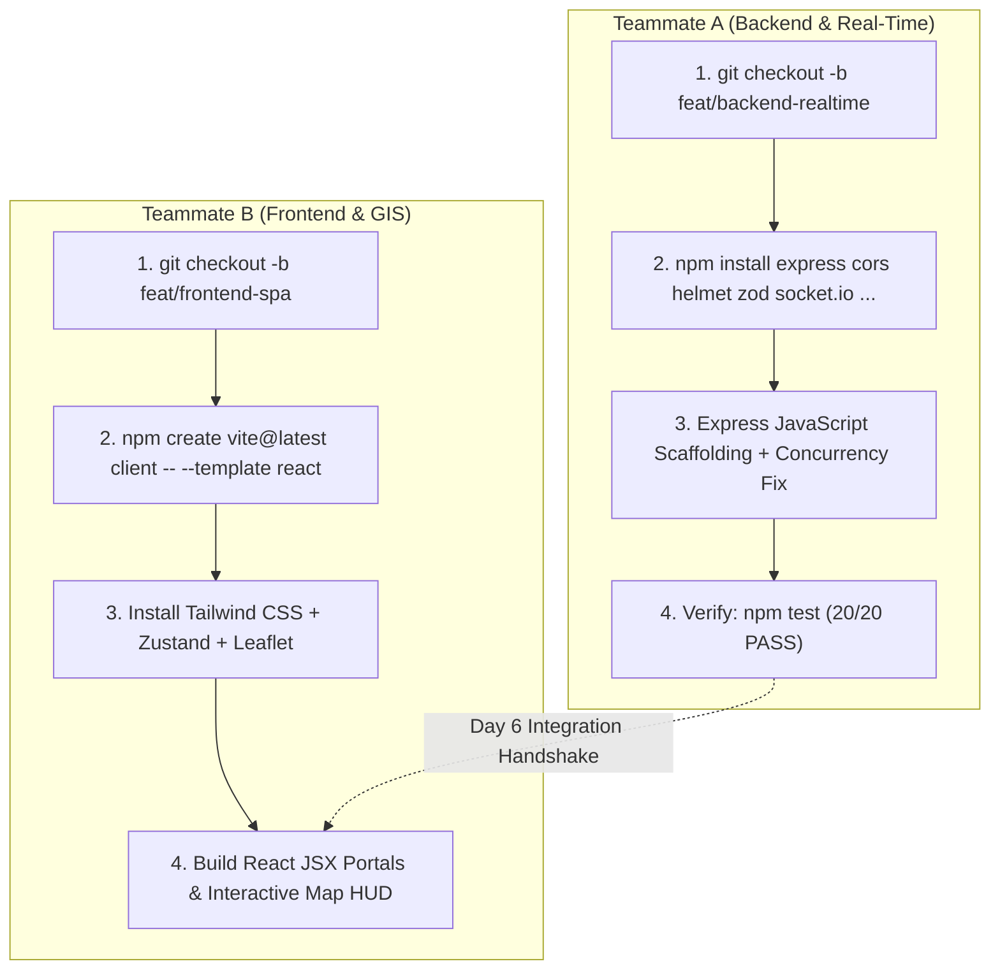

# 🏁 Day 1 Kickoff & Onboarding Guide for Teammate A & Teammate B

> 🚖 **CabGo Enterprise Modernization**: Parallel Execution Guide (Pure Modern JavaScript)  
> ⚡ **Stack**: React 19 (JavaScript / JSX) · Node.js & Express.js · Socket.IO · Redis · MySQL 8.0 · Leaflet · Docker  
> 🚫 **No TypeScript**: All code is written in pure standard JavaScript (`.js` and `.jsx`). Zero build-step compilation overhead.  
> 📖 **Master Specifications**: See [PRODUCTION_MIGRATION_PLAN.md](PRODUCTION_MIGRATION_PLAN.md) and [TEAM_PLAN.md](TEAM_PLAN.md).

---

## 👥 Overview: Parallel Team Strategy

Teammate A and Teammate B can work **100% in parallel** without stepping on each other's code or encountering Git merge conflicts due to strict physical directory separation:
- **Teammate A** works exclusively inside `server/`, `database/`, and root Docker files on branch `feat/backend-realtime`.
- **Teammate B** works exclusively inside `client/` on branch `feat/frontend-spa`.



---

## 🛠️ Teammate A: Backend, Real-Time & Infra Lead

### 📌 Your Responsibilities
- **Assigned Phases**: Phase 1 (Backend Core), Phase 2 (Socket.IO + Redis), Phase 5 (Docker & Supertest).
- **Directory Scope**: `server/`, `database/`, `docker-compose.yml`, `Dockerfile`.
- **Language**: Pure Modern JavaScript (CommonJS / Node.js ES6+).
- **Git Branch**: `feat/backend-realtime`.

### 🚀 Step 1: Branch Setup & Dependency Installation
Open your terminal in the repository root and execute:

```bash
# 1. Create and switch to your dedicated branch
git checkout -b feat/backend-realtime

# 2. Install production backend & real-time dependencies
npm install express dotenv cors helmet zod mysql2 socket.io @socket.io/redis-adapter ioredis jsonwebtoken bcryptjs pino pino-pretty

# 3. Install testing tools (pure JS, no TypeScript needed)
npm install --save-dev vitest supertest
```

### 📋 Day 1–2 Implementation Tasks for Teammate A:

#### Task A1: Express Application Scaffolding (`server/app.js`)
Create a clean Express application that standardizes middleware and mounts existing routes:
```javascript
'use strict';
const express = require('express');
const cors = require('cors');
const helmet = require('helmet');

const app = express();

app.use(helmet({ contentSecurityPolicy: false }));
app.use(cors({ origin: '*' }));
app.use(express.json());
app.use(express.static('public'));

// Health check endpoint
app.get('/api/health', (req, res) => {
  res.json({ success: true, status: 'healthy', timestamp: new Date().toISOString() });
});

module.exports = app;
```

#### Task A2: Fix the SSE `decodeToken` Fatal Runtime Crash
In [`server/middleware/auth.js`](server/middleware/auth.js), ensure `verifyToken` is exported as `decodeToken` as well:
```javascript
module.exports = { 
  createToken, 
  verifyToken, 
  decodeToken: verifyToken, // Fixes runtime error in server/routes/stream.js
  authenticate, 
  requireRole 
};
```

#### Task A3: Fix the Concurrency Race Condition (Double-Booking Bug)
In [`server/routes/driver.js`](server/routes/driver.js) inside the ride-acceptance handler (`PUT /api/driver/ride-requests/:id/accept`), replace the naive read-then-write sequence with an atomic compare-and-swap update:
```javascript
// Execute atomic conditional update in standard MySQL
const [updateResult] = await conn.execute(
  `UPDATE ride_requests 
   SET status = 'accepted' 
   WHERE request_id = ? AND status = 'pending'`,
  [requestId]
);

// If affectedRows === 0, another driver already accepted this ride!
if (updateResult.affectedRows === 0) {
  await conn.rollback();
  return req.sendJSON(409, {
    success: false,
    message: 'This ride has already been accepted by another driver.'
  });
}
```

#### Task A4: Attach Socket.IO to the Server
In `server/server.js`, attach Socket.IO:
```javascript
const { Server } = require('socket.io');

const io = new Server(server, {
  cors: { origin: '*', methods: ['GET', 'POST', 'PUT'] }
});

io.on('connection', (socket) => {
  console.log('[Socket.IO] Client connected:', socket.id);

  // Driver GPS heartbeat
  socket.on('driver:ping_location', (data) => {
    socket.broadcast.emit('driver:location_tick', data);
  });

  // Join trip room
  socket.on('trip:join', (tripId) => {
    socket.join(`trip:${tripId}`);
    console.log(`Socket ${socket.id} joined room trip:${tripId}`);
  });
});
```

#### Task A5: Verify Everything Still Passes
Run:
```bash
npm test
```
*Requirement*: All 20 E2E tests must continue to output `✅ PASS`.

---

## 🎨 Teammate B: Frontend & GIS UI Lead

### 📌 Your Responsibilities
- **Assigned Phases**: Phase 3 (React SPA Core), Phase 4 (Leaflet GIS Maps & HUD), Phase 6 (Playwright E2E).
- **Directory Scope**: `client/` *(brand new isolated folder)*.
- **Language**: Pure React 19 + JavaScript (`.jsx` / `.js`).
- **Git Branch**: `feat/frontend-spa`.

### 🚀 Step 1: Branch Setup & Vite React Scaffold (Pure JavaScript)
Open your terminal in the repository root and execute:

```bash
# 1. Create and switch to your dedicated branch
git checkout -b feat/frontend-spa

# 2. Scaffold React 19 JavaScript SPA inside client/ (use template 'react', NOT 'react-ts')
npm create vite@latest client -- --template react

# 3. Enter client directory & install UI dependencies
cd client
npm install react-router-dom zustand @tanstack/react-query lucide-react clsx tailwindcss postcss autoprefixer socket.io-client leaflet react-leaflet axios

# 4. Initialize Tailwind CSS
npx tailwindcss init -p
```

### 📋 Day 1–2 Implementation Tasks for Teammate B:

#### Task B1: Configure Tailwind CSS (`client/tailwind.config.js`)
```javascript
/** @type {import('tailwindcss').Config} */
export default {
  content: ["./index.html", "./src/**/*.{js,jsx}"],
  theme: {
    extend: {
      colors: {
        brand: {
          yellow: "#F59E0B",
          dark: "#0F172A",
          emerald: "#10B981",
        }
      }
    },
  },
  plugins: [],
}
```

#### Task B2: Setup Base API & Socket Clients (`client/src/services/api.js`)
Connect directly to the running backend on port 5000:
```javascript
import axios from 'axios';

export const api = axios.create({
  baseURL: 'http://localhost:5000/api',
  headers: { 'Content-Type': 'application/json' },
});

api.interceptors.request.use((config) => {
  const token = localStorage.getItem('cab_token');
  if (token) {
    config.headers.Authorization = `Bearer ${token}`;
  }
  return config;
});
```

And `client/src/services/socket.js`:
```javascript
import { io } from 'socket.io-client';

export const socket = io('http://localhost:5000', {
  autoConnect: false,
});
```

#### Task B3: Setup Centralized State Stores with Zustand (`client/src/store/authStore.js`)
```javascript
import { create } from 'zustand';

export const useAuthStore = create((set) => ({
  token: localStorage.getItem('cab_token'),
  user: localStorage.getItem('cab_user') ? JSON.parse(localStorage.getItem('cab_user')) : null,
  login: (token, user) => {
    localStorage.setItem('cab_token', token);
    localStorage.setItem('cab_user', JSON.stringify(user));
    set({ token, user });
  },
  logout: () => {
    localStorage.removeItem('cab_token');
    localStorage.removeItem('cab_user');
    set({ token: null, user: null });
  },
}));
```

#### Task B4: Setup React Router & Portals (`client/src/App.jsx`)
Create routes for the 4 portals:
```jsx
import { BrowserRouter, Routes, Route, Navigate } from 'react-router-dom';
import Login from './pages/auth/Login';
import PassengerDashboard from './pages/passenger/Dashboard';
import BookRide from './pages/passenger/BookRide';
import ActiveTrip from './pages/passenger/ActiveTrip';
import DriverDashboard from './pages/driver/Dashboard';

export default function App() {
  return (
    <BrowserRouter>
      <Routes>
        <Route path="/login" element={<Login />} />
        <Route path="/passenger/dashboard" element={<PassengerDashboard />} />
        <Route path="/passenger/book-ride" element={<BookRide />} />
        <Route path="/passenger/active-trip" element={<ActiveTrip />} />
        <Route path="/driver/dashboard" element={<DriverDashboard />} />
        <Route path="*" element={<Navigate to="/login" replace />} />
      </Routes>
    </BrowserRouter>
  );
}
```

#### Task B5: Leaflet GIS Map Component (`client/src/components/map/LeafletMap.jsx`)
Replace the legacy mock SVG curve with a real OpenStreetMap tile view:
```jsx
import { MapContainer, TileLayer, Marker, Popup } from 'react-leaflet';
import 'leaflet/dist/leaflet.css';

export default function LeafletMap({ pickupCoords, dropCoords, driverCoords }) {
  const center = pickupCoords || [13.0827, 80.2707]; // Default Chennai

  return (
    <MapContainer center={center} zoom={13} style={{ height: '400px', width: '100%', borderRadius: '16px' }}>
      <TileLayer
        attribution='&copy; <a href="https://www.openstreetmap.org/copyright">OpenStreetMap</a>'
        url="https://{s}.tile.openstreetmap.org/{z}/{x}/{y}.png"
      />
      {pickupCoords && <Marker position={pickupCoords}><Popup>Pickup Location</Popup></Marker>}
      {dropCoords && <Marker position={dropCoords}><Popup>Destination</Popup></Marker>}
      {driverCoords && <Marker position={driverCoords}><Popup>Driver Partner</Popup></Marker>}
    </MapContainer>
  );
}
```

---

## 🤝 The Day 6 Handshake (Integration & PR Review)

On Day 6 of the sprint:
1. **Teammate A** submits Pull Request: `feat/backend-realtime` -> `main`.
   - All tests pass via `npm test`.
   - Server runs on `http://localhost:5000` with Express and Socket.IO active.
2. **Teammate B** submits Pull Request: `feat/frontend-spa` -> `main`.
   - `client/` builds cleanly via `npm run build`.
   - Connects to `http://localhost:5000` and verifies live booking and tracking.
3. Both branches are merged into `main` with **zero merge conflicts**!

---

> 💬 **Questions or Blockers?** Refer to the complete event catalog and database schema in [PRODUCTION_MIGRATION_PLAN.md](PRODUCTION_MIGRATION_PLAN.md).
