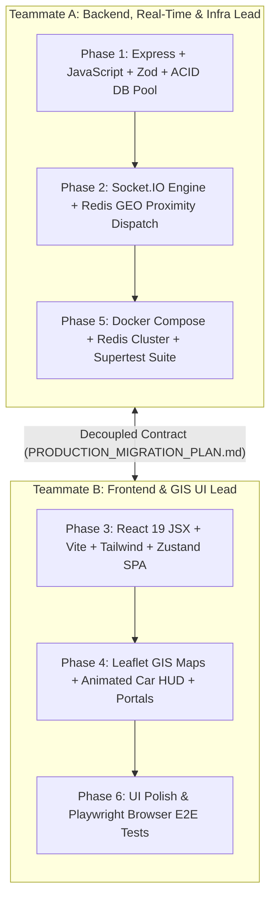
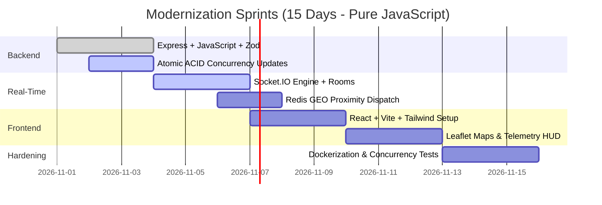

# 🚖 Online Cab Booking System — Team Project Plan

> **Web Technology CIA Assignment**  
> **Stack**: HTML/CSS · Vanilla JavaScript · DOM · AJAX/Fetch · Node.js (built-in modules only) · MySQL  
> **Restriction**: ❌ No React, Angular, Vue, Express.js, or any external web framework  
> **Cadence**: 2–3 commits per day → ~30 commits total over 10 days

---

## 🚀 PRODUCTION UPGRADE: Next-Gen Architecture & Modernization Plan

> 🚀 **PRODUCTION MIGRATION IN PROGRESS**: The team is transitioning CabGo from the original raw HTML/Node.js academic proof-of-concept into an enterprise-grade production platform.  
> 📖 **Comprehensive Implementation Specification**: See [PRODUCTION_MIGRATION_PLAN.md](PRODUCTION_MIGRATION_PLAN.md) for full architecture diagrams, Socket.IO event contracts, concurrency safeguards, and Docker configuration.  
> 🏁 **Parallel Kickoff Guide**: See [TEAMMATE_KICKOFF.md](TEAMMATE_KICKOFF.md) for copy-pasteable Day 1 commands and file setups for Teammates A & B.

### 👥 Workstream Assignments
| Stream | Focus Area | Technologies | Owner / Lead |
| :--- | :--- | :--- | :--- |
| **Stream 1: Backend Core** | Express API, JavaScript (Node.js ES6+), Zod validation, ACID MySQL pool | Express, Node.js JS, Zod, `mysql2/promise` | Backend Lead |
| **Stream 2: Real-Time & Infra** | Socket.IO server, Redis Pub/Sub adapter, Redis GEO proximity dispatch | Socket.IO, Redis 7.x, Docker Compose | Real-Time / DevOps Lead |
| **Stream 3: Modern SPA Frontend** | React 19 (JavaScript JSX), Vite, Tailwind CSS, Zustand, Leaflet GIS maps | React JSX, Vite, JavaScript, Tailwind, Leaflet | Frontend Lead |
| **Stream 4: Testing & Concurrency** | Vitest unit tests, Supertest API suite, k6 double-booking stress test | Vitest, Supertest, Playwright, k6 | QA / Test Lead |

---

### 🔀 Parallel Team Work Allocation (2-Teammate vs 3-Person Breakdown)

#### Scenario A: 2 Teammates (Frontend vs Backend/Real-Time Split)


- **Teammate A (Backend & Real-Time)**:
  - **Phases Owned**: Phase 1, Phase 2, Phase 5.
  - **Directory Scope**: `server/`, `database/`, `docker-compose.yml`, `Dockerfile`.
  - **Language**: Pure Modern JavaScript (CommonJS / Node.js ES6+).
  - **Git Branch**: `feat/backend-realtime`.
  - **Deliverables**: Express REST endpoints, atomic compare-and-swap SQL queries, Socket.IO rooms and Redis proximity matching.
- **Teammate B (Frontend & GIS)**:
  - **Phases Owned**: Phase 3, Phase 4, Phase 6.
  - **Directory Scope**: `client/` (new Vite SPA directory).
  - **Language**: Pure React 19 + JavaScript (`.jsx` / `.js`).
  - **Git Branch**: `feat/frontend-spa`.
  - **Deliverables**: Modern single-page application with 4 role-based portals (Passenger, Driver, Admin, SuperAdmin), Leaflet maps, live telemetry HUD.
- **Why they never block each other**:
  - **Zero Git Merge Conflicts**: Teammate A only touches `server/`; Teammate B only touches `client/`.
  - **Pre-agreed Contract**: Teammate B codes against the event specifications in `PRODUCTION_MIGRATION_PLAN.md` without waiting for backend completion.

---

#### Scenario B: 3-Person Split (You + 2 Teammates)
| Role / Person | Focus Area | Phases Owned | File Boundary |
| :--- | :--- | :--- | :--- |
| **Teammate 1 (Backend Core & DB)** | Express REST API, JavaScript, Zod schemas, MySQL connection pool, atomic updates, JWT auth cookies, Docker. | **Phase 1 & Phase 5** | `server/src/routes/`, `server/src/controllers/`, `docker-compose.yml` |
| **Teammate 2 (Real-Time & GIS)** | Socket.IO server gateway, Redis GEO driver proximity index, Leaflet map polyline integration, live car animation. | **Phase 2 & Phase 4** | `server/src/sockets/`, `client/src/components/map/` |
| **Teammate 3 / You (Frontend SPA & QA Lead)** | Vite React JavaScript scaffold, Tailwind design system, Zustand stores, 4 portals (Passenger, Driver, Admin, SuperAdmin), E2E test verification. | **Phase 3 & Phase 6** | `client/src/pages/`, `client/src/store/`, `e2e_test.js` |


### 🗓️ 5-Sprint Implementation Schedule


### 📋 Team Implementation Checklist (Next Actions)
- [ ] **Backend**: Initialize `server/` with `express`, `cors`, `helmet`, and `zod` (Pure JavaScript).
- [ ] **Backend**: Implement atomic SQL update for ride acceptance (`UPDATE ride_requests SET status = 'accepted' WHERE request_id = ? AND status = 'pending'`).
- [ ] **Real-Time**: Attach `Socket.io` to Express server and configure Redis Pub/Sub adapter.
- [ ] **Real-Time**: Implement `driver:ping_location` with Redis `GEOADD` and `GEOSEARCH` within 5km.
- [ ] **Frontend**: Scaffold Vite React app in `client/` using `--template react` with Tailwind CSS and Zustand stores (`useAuthStore.js`, `useTripStore.js`).
- [ ] **Frontend**: Replace SVG path `roadBed` with Leaflet OpenStreetMap tiles and animated car marker.
- [ ] **QA**: Port `e2e_test.js` to `supertest` + `vitest` and write race condition test script.

---

## 🏛️ Historical Context (Original CIA Academic Plan)
*(The section below documents the original raw vanilla JS/Node.js implementation developed under strict zero-framework constraints).*

---

## 👥 Team Workflow Rules

1. **Commit naming convention**: `feat(scope): description` | `fix(scope): description` | `chore: description`
2. **One commit = one logical unit** — don't bundle unrelated changes
3. **Test your API** with a browser fetch or Postman before committing
4. **Never push broken code to main** — use feature branches if working in parallel
5. **Database changes** always go in `database/schema.sql` — never alter DB manually without updating the file

---

## 📁 Full Project Folder Structure

```
cab-booking/                          ← project root
├── server/
│   ├── server.js                     # Entry point – raw Node.js http server
│   ├── router.js                     # URL dispatcher (replaces express router)
│   ├── db.js                         # MySQL connection pool
│   ├── middleware/
│   │   ├── auth.js                   # Token validation + role extraction
│   │   └── logger.js                 # Writes to system_logs table on every API call
│   ├── routes/
│   │   ├── auth.js                   # Register, login, logout, /me
│   │   ├── passenger.js              # Passenger-specific APIs
│   │   ├── driver.js                 # Driver-specific APIs
│   │   ├── admin.js                  # Admin APIs
│   │   └── superadmin.js             # Super Admin APIs
│   └── utils/
│       └── fareCalculator.js         # Fare estimation logic
├── public/
│   ├── index.html                    # Landing page (public)
│   ├── login.html                    # Login page (public)
│   ├── register.html                 # Registration page (public)
│   ├── search-ride.html              # Search available rides (public)
│   ├── passenger/
│   │   ├── dashboard.html
│   │   ├── book-ride.html
│   │   ├── active-trip.html
│   │   ├── trip-history.html
│   │   └── profile.html
│   ├── driver/
│   │   ├── dashboard.html
│   │   ├── ride-requests.html
│   │   ├── active-trip.html
│   │   ├── vehicles.html
│   │   ├── earnings.html
│   │   └── profile.html
│   ├── admin/
│   │   ├── dashboard.html
│   │   ├── manage-passengers.html
│   │   ├── manage-drivers.html
│   │   ├── manage-vehicles.html
│   │   ├── manage-trips.html
│   │   ├── fare-rules.html
│   │   └── reports.html
│   ├── superadmin/
│   │   ├── dashboard.html
│   │   ├── manage-admins.html
│   │   ├── permissions.html
│   │   ├── system-logs.html
│   │   └── system-settings.html
│   ├── css/
│   │   ├── global.css                # Design tokens, typography, dark mode base
│   │   ├── auth.css                  # Login/register page styles
│   │   ├── dashboard.css             # Dashboard layouts (sidebar, cards)
│   │   └── components.css            # Modals, toasts, tables, buttons
│   └── js/
│       ├── api.js                    # Fetch wrapper with token injection + error handling
│       ├── auth.js                   # Login/logout/register DOM logic
│       ├── router-guard.js           # Role-based page access guard
│       ├── passenger/
│       │   ├── dashboard.js
│       │   ├── book-ride.js
│       │   ├── active-trip.js
│       │   └── trip-history.js
│       ├── driver/
│       │   ├── dashboard.js
│       │   ├── ride-requests.js
│       │   ├── active-trip.js
│       │   └── earnings.js
│       ├── admin/
│       │   ├── dashboard.js
│       │   ├── manage-users.js
│       │   ├── manage-trips.js
│       │   └── reports.js
│       └── superadmin/
│           ├── dashboard.js
│           ├── manage-admins.js
│           └── system-logs.js
├── database/
│   ├── schema.sql                    # Full DDL – all 12 tables with FK constraints
│   └── seed.sql                      # Demo data
├── .env                              # DB credentials (NEVER commit this)
├── .env.example                      # Template for env vars (commit this)
├── .gitignore
├── package.json
└── TEAM_PLAN.md                      # ← YOU ARE HERE
```

---

## 🗓️ 10-Day Execution Plan

---

### ✅ DAY 1 — Project Scaffolding + Database Design + Raw Server
**Goal**: Repo initialized, DB schema finalized, raw server running on localhost:3000

#### Commit 1 — `chore: project scaffold & package.json`
- [x] Create full folder structure (empty files/folders)
- [x] Initialize `package.json` (only allowed dependency: `mysql2`)
- [x] Create `.gitignore` (node_modules, .env)
- [x] Create `.env.example` with DB config template
- [x] Write basic `README.md`

#### Commit 2 — `feat(db): complete MySQL schema – all 12 tables`
- [x] `database/schema.sql` — all 12 tables with PK/FK/INDEX/ENUM:
  - `users`, `passenger_profiles`, `driver_profiles`
  - `vehicles`, `service_areas`, `fare_rules`
  - `ride_requests`, `trips`, `payments`
  - `ratings_reviews`, `admin_permissions`, `system_logs`

#### Commit 3 — `feat(server): raw Node.js HTTP server + DB pool + router + logger`
- [x] `server/db.js` — MySQL2 pool with `.env` config
- [x] `server/server.js` — `http.createServer`, static file serving from `/public`
- [x] `server/router.js` — URL pattern matching dispatcher
- [x] `server/middleware/logger.js` — logs every API call to `system_logs`
- [x] **Test**: `node server/server.js` → `localhost:3000` serves index.html

---

### ✅ DAY 2 — Authentication APIs + Public Pages UI
**Goal**: Registration, login, HMAC-signed session token, public HTML pages live

#### Commit 1 — `feat(auth): register & login REST APIs`
- [x] `POST /api/auth/register` — insert `users` + role profile
- [x] `POST /api/auth/login` — validate, return HMAC-signed token
- [x] `POST /api/auth/logout`
- [x] `GET /api/auth/me` — decode token, return user info
- [x] `server/middleware/auth.js` — token decode + role check

#### Commit 2 — `feat(ui): index.html, login.html, register.html`
- [x] `public/index.html` — Landing: hero, features, CTAs
- [x] `public/login.html` — Login form with Fetch submission
- [x] `public/register.html` — Tabbed: Passenger / Driver tabs
- [x] `public/css/global.css` — color palette, typography (Inter, Outfit), CSS variables
- [x] `public/css/auth.css` — glassmorphism cards, gradients
- [x] `public/js/api.js` — reusable fetch wrapper
- [x] `public/js/auth.js` — form logic, DOM error display, redirect on success

#### Commit 3 — `feat(ui): search-ride.html + role-based route guard`
- [x] `public/search-ride.html` — pickup/destination inputs, vehicle filter
- [x] `public/js/router-guard.js` — read token from `sessionStorage`, decode role, redirect if unauthorized

---

### ✅ DAY 3 — Passenger Dashboard + Book Ride APIs
**Goal**: Passenger can search, book, track, and view trip history

#### Commit 1 — `feat(api): ride search + book ride endpoints`
- [x] `GET /api/rides/search?pickup=&destination=&type=`
- [x] `POST /api/rides/book` — insert `ride_requests`, status = `pending`
- [x] `GET /api/rides/status/:request_id`
- [x] `POST /api/rides/cancel/:request_id` — only if `pending`

#### Commit 2 — `feat(ui): passenger-dashboard.html + book-ride.html`
- [x] Dashboard: summary cards, recent bookings list (AJAX), quick actions
- [x] Book-ride: pickup + destination, vehicle selector, fare estimate (AJAX), confirm booking

#### Commit 3 — `feat(ui): active-trip.html + trip-history.html (passenger)`
- [x] Active trip: poll status every 5 sec via `setInterval` + Fetch, cancel button
- [x] Trip history: table DOM-rendered from Fetch, date filter without reload

---

### ✅ DAY 4 — Driver Dashboard + Ride Management APIs
**Goal**: Driver can go online, receive requests, accept/reject, start/end trips

#### Commit 1 — `feat(api): driver availability + ride request APIs`
- [x] `PUT /api/driver/availability` — toggle online/offline
- [x] `GET /api/driver/ride-requests` — pending requests
- [x] `PUT /api/driver/ride-requests/:id/accept`
- [x] `PUT /api/driver/ride-requests/:id/reject`
- [x] `PUT /api/driver/trips/:id/start`
- [x] `PUT /api/driver/trips/:id/complete`

#### Commit 2 — `feat(ui): driver-dashboard.html + ride-requests.html`
- [x] Dashboard: online/offline toggle, live stats, ride request notification (poll 10 sec)
- [x] Ride requests: list with accept/reject buttons, DOM status update (no reload)

#### Commit 3 — `feat(ui): driver active-trip.html + earnings.html`
- [x] Active trip: Start → Complete flow, status badge DOM update
- [x] Earnings: total + per-trip breakdown, date filter (week/month)

---

### ✅ DAY 5 — Vehicle Management + Driver Profile + Ratings
**Goal**: Drivers manage vehicles; passengers rate completed trips

#### Commit 1 — `feat(api): vehicle CRUD + profile APIs`
- [x] `GET/POST/PUT/DELETE /api/driver/vehicles`
- [x] `GET/PUT /api/driver/profile`
- [x] `GET/PUT /api/passenger/profile`

#### Commit 2 — `feat(ui): vehicles.html + profile pages`
- [x] Vehicles: table + Add/Edit modal + Delete → Fetch CRUD, DOM update
- [x] Profile pages (driver + passenger): editable form, success toast on save

#### Commit 3 — `feat(api+ui): ratings & reviews module`
- [x] `POST /api/ratings` — submit after trip complete
- [x] `GET /api/ratings/driver/:id` / `GET /api/ratings/passenger/:id`
- [x] Star-rating widget post-trip modal
- [x] Driver profile: average rating + reviews list (DOM rendered)

---

### ✅ DAY 6 — Payment Module + Fare Rules APIs
**Goal**: Payment recording; admin fare rule and service area management

#### Commit 1 — `feat(api): payments module`
- [x] `POST /api/payments` — record payment (auto-trigger on trip complete)
- [x] `GET /api/payments/trip/:trip_id`
- [x] `GET /api/passenger/payments` — payment history

#### Commit 2 — `feat(api): admin – fare rules + service areas APIs`
- [x] `GET/POST/PUT/DELETE /api/admin/fare-rules`
- [x] `GET/POST/PUT/DELETE /api/admin/service-areas`
- [x] `server/utils/fareCalculator.js`: `estimatedFare = base_fare + (km × per_km_rate) + (min × per_minute_rate)`

#### Commit 3 — `feat(ui): fare-rules.html (admin)`
- [x] Fare rules table + Add/Edit modal CRUD via Fetch, DOM-updated
- [x] Service areas table + same CRUD pattern

---

### ✅ DAY 7 — Admin Dashboard + Manage Users/Trips
**Goal**: Admin can manage all passengers, drivers, vehicles, and trips

#### Commit 1 — `feat(api): admin – users & vehicles management APIs`
- [x] `GET /api/admin/passengers` (paginated)
- [x] `GET /api/admin/drivers`
- [x] `PUT /api/admin/drivers/:id/approve|reject|block|unblock`
- [x] `PUT /api/admin/passengers/:id/block|unblock`
- [x] `GET /api/admin/vehicles` + `PUT /api/admin/vehicles/:id/status`

#### Commit 2 — `feat(ui): admin-dashboard.html + manage-passengers/drivers.html`
- [x] Dashboard: KPI cards, activity feed, vanilla Canvas charts
- [x] Manage passengers: search + paginate + block/unblock (DOM update)
- [x] Manage drivers: approve/reject/block with confirmation modal

#### Commit 3 — `feat(ui): manage-vehicles.html + manage-trips.html (admin)`
- [x] Vehicles: all vehicles table, activate/deactivate
- [x] Trips: filter by status, admin mark-complete

---

### ✅ DAY 8 — Reports Module + Super Admin Foundation
**Goal**: Admin reports with live charts; Super Admin user management

#### Commit 1 — `feat(api): reports + system logs APIs`
- [x] `GET /api/admin/reports/revenue?from=&to=`
- [x] `GET /api/admin/reports/trips?status=&from=&to=`
- [x] `GET /api/admin/reports/drivers`
- [x] `GET /api/superadmin/logs?user=&action=&from=&to=`

#### Commit 2 — `feat(ui): reports.html (admin)`
- [x] Date pickers + filters, revenue table + vanilla Canvas bar chart
- [x] Driver performance table, CSV export via DOM Blob download

#### Commit 3 — `feat(api+ui): superadmin – admins + permissions`
- [x] `GET/POST/PUT/DELETE /api/superadmin/admins`
- [x] `PUT /api/superadmin/admins/:id/activate|deactivate`
- [x] `GET/POST/DELETE /api/superadmin/permissions/:admin_id`
- [x] `manage-admins.html` + `permissions.html`

---

### ✅ DAY 9 — Super Admin Settings + System Logs + Security Hardening
**Goal**: Super Admin panel complete; security & middleware polished

#### Commit 1 — `feat(ui): superadmin-dashboard.html + system-logs.html`
- [x] Dashboard: global KPIs, all admin overview
- [x] System logs: filter by user/action/date/IP, paginated DOM table

#### Commit 2 — `feat(ui): system-settings.html`
- [x] Platform settings: name, currency, max cancellations, maintenance mode toggle
- [x] `PUT /api/superadmin/settings`

#### Commit 3 — `feat(security): input validation, rate limiting, RBAC hardening`
- [x] Server-side input sanitization on all POST/PUT routes
- [x] `server/middleware/rateLimit.js` — in-memory IP rate limiting
- [x] Audit all routes: token + role enforced everywhere
- [x] CORS headers in `server.js`
- [x] `system_logs` written on all CUD operations

---

### ✅ DAY 10 — UI Polish + Validation + Testing + Final Release
**Goal**: System fully integrated, polished, seeded, tagged v1.0.0

#### Commit 1 — `feat(ui): global UI polish + responsive design`
- [x] Dark mode palette finalized across all pages
- [x] Mobile-first responsive breakpoints
- [x] Sidebar nav component for all dashboards
- [x] Toast notification system (success/error)
- [x] Skeleton loaders during Fetch calls
- [x] All pages: `<title>`, meta description, semantic HTML5 elements

#### Commit 2 — `feat(validation): client-side form validation + error handling`
- [x] `public/js/validator.js` — email, phone, password strength, required fields
- [x] Wire to all forms: register, book, vehicle add, profile edit
- [x] Inline server error display via DOM (no `alert()`)
- [x] Network error banner + token expiry auto-redirect

#### Commit 3 — `chore: seed data + README + v1.0.0 tag`
- [x] `database/seed.sql`: 1 superadmin, 2 admins, 5 passengers, 5 drivers, 8 vehicles, sample trips/payments/ratings
- [x] Final `README.md`: setup steps + test credentials per role
- [x] E2E checklist: passenger books → driver accepts → admin reports → superadmin logs
- [x] Git tag: `v1.0.0`

---

### ✅ DAY 11 — Real-Time Transit Telemetry with Server-Sent Events (SSE)
**Goal**: Native Node.js HTTP Server-Sent Events broker, simulated GPS coordinates streaming, and browser EventSource listener with live car sprite animation.

#### Commit 1 — `feat(sse): raw Node.js Server-Sent Events broker`
- [x] `server/sseBroker.js` — zero-dependency SSE stream initializer (`text/event-stream; charset=utf-8`)
- [x] Keepalive heartbeat ping interval (15s) and subscriber registries (`tripSubscribers`, `driverSubscribers`, `adminSubscribers`)
- [x] Stream route bypass in `server/server.js` for persistent SSE sockets

#### Commit 2 — `feat(telemetry): live simulated GPS coordinates stream`
- [x] `server/telemetry.js` — Chennai landmark coordinates database, bearing calculation, route waypoints generator
- [x] 2.5s telemetry broadcast simulation pushing `{ lat, lng, bearing, speed_kmh, eta_minutes, progress_percent }`
- [x] Hooked triggers in `server/routes/passenger.js` (book dispatch, cancel cleanup) and `server/routes/driver.js` (accept, start, complete)
- [x] `server/routes/stream.js` — endpoints for `/api/stream/trip/:id`, `/api/stream/driver-dispatch`, `/api/stream/admin-live`

#### Commit 3 — `feat(ui): EventSource listener & car sprite animation`
- [x] `public/passenger/active-trip.html` — live SVG route track, animated glowing car sprite 🚖 with `getPointAtLength` trajectory interpolation
- [x] Real-time speedometer gauge, ETA calculator, compass bearing ticker, and SSE stream status badge
- [x] `public/driver/active-trip.html` — live telemetry HUD synchronization and instant passenger cancellation handling
- [x] `public/driver/ride-requests.html` — SSE dispatch feed with pure Web Audio API synthesizer chime and instant offer card prepending

---

## 📊 Week Roadmap & Commit Summary Table

| Day | Commit 1 | Commit 2 | Commit 3 |
|-----|----------|----------|----------|
| 1 | Project scaffold | MySQL schema (12 tables) | Raw Node.js server + DB pool |
| 2 | Auth APIs | Public pages UI | Search-ride + route guard |
| 3 | Ride search + book APIs | Passenger dashboard + book-ride UI | Active trip + trip history UI |
| 4 | Driver availability + ride APIs | Driver dashboard + ride-requests UI | Driver active-trip + earnings UI |
| 5 | Vehicle CRUD + profile APIs | Vehicles + profile pages UI | Ratings & reviews module |
| 6 | Payments APIs | Fare rules + service area APIs | Fare-rules admin UI |
| 7 | Admin user management APIs | Admin dashboard + manage users | Manage vehicles + trips UI |
| 8 | Reports + logs APIs | Reports UI (canvas charts) | Super Admin admins + permissions |
| 9 | Super Admin dashboard + logs UI | System settings UI | Security hardening |
| 10 | Global UI polish | Form validation + error handling | Seed data + README + v1.0.0 |
| 11 | Raw Node.js SSE Broker | Simulated GPS Telemetry Stream | EventSource UI & Car Animation |

---

## 🔗 Complete REST API Reference

### Auth
| Method | Endpoint | Role | Description |
|--------|----------|------|-------------|
| POST | `/api/auth/register` | Public | Register passenger or driver |
| POST | `/api/auth/login` | Public | Login → returns token |
| POST | `/api/auth/logout` | All | Invalidate session |
| GET | `/api/auth/me` | All | Current user info from token |

### Rides (Passenger)
| Method | Endpoint | Role | Description |
|--------|----------|------|-------------|
| GET | `/api/rides/search` | All | Search available cabs + fare estimate |
| POST | `/api/rides/book` | Passenger | Book a cab |
| GET | `/api/rides/status/:id` | Passenger | Booking/trip status |
| POST | `/api/rides/cancel/:id` | Passenger | Cancel if pending |
| GET | `/api/passenger/trips` | Passenger | Trip history |
| GET | `/api/passenger/payments` | Passenger | Payment history |
| GET | `/api/passenger/profile` | Passenger | View profile |
| PUT | `/api/passenger/profile` | Passenger | Update profile |

### Driver
| Method | Endpoint | Role | Description |
|--------|----------|------|-------------|
| PUT | `/api/driver/availability` | Driver | Toggle online/offline |
| GET | `/api/driver/ride-requests` | Driver | Pending ride requests |
| PUT | `/api/driver/ride-requests/:id/accept` | Driver | Accept a ride |
| PUT | `/api/driver/ride-requests/:id/reject` | Driver | Reject a ride |
| PUT | `/api/driver/trips/:id/start` | Driver | Start a trip |
| PUT | `/api/driver/trips/:id/complete` | Driver | Complete a trip |
| GET | `/api/driver/earnings` | Driver | Earnings summary |
| GET | `/api/driver/vehicles` | Driver | List vehicles |
| POST | `/api/driver/vehicles` | Driver | Add vehicle |
| PUT | `/api/driver/vehicles/:id` | Driver | Update vehicle |
| DELETE | `/api/driver/vehicles/:id` | Driver | Remove vehicle |
| GET | `/api/driver/profile` | Driver | View profile |
| PUT | `/api/driver/profile` | Driver | Update profile |

### Ratings & Payments
| Method | Endpoint | Role | Description |
|--------|----------|------|-------------|
| POST | `/api/ratings` | Passenger/Driver | Submit rating |
| GET | `/api/ratings/driver/:id` | All | Driver ratings |
| GET | `/api/ratings/passenger/:id` | All | Passenger ratings |
| POST | `/api/payments` | System | Record payment |
| GET | `/api/payments/trip/:id` | Auth | Payment for a trip |

### Admin
| Method | Endpoint | Role | Description |
|--------|----------|------|-------------|
| GET | `/api/admin/passengers` | Admin | List all passengers (paginated) |
| PUT | `/api/admin/passengers/:id/block` | Admin | Block passenger |
| PUT | `/api/admin/passengers/:id/unblock` | Admin | Unblock passenger |
| GET | `/api/admin/drivers` | Admin | List all drivers |
| PUT | `/api/admin/drivers/:id/approve` | Admin | Approve driver |
| PUT | `/api/admin/drivers/:id/reject` | Admin | Reject driver |
| PUT | `/api/admin/drivers/:id/block` | Admin | Block driver |
| GET | `/api/admin/vehicles` | Admin | All vehicles |
| PUT | `/api/admin/vehicles/:id/status` | Admin | Update vehicle status |
| GET | `/api/admin/trips` | Admin | All trips (with filters) |
| PUT | `/api/admin/trips/:id/complete` | Admin | Force-complete a trip |
| GET | `/api/admin/fare-rules` | Admin | List fare rules |
| POST | `/api/admin/fare-rules` | Admin | Create fare rule |
| PUT | `/api/admin/fare-rules/:id` | Admin | Update fare rule |
| DELETE | `/api/admin/fare-rules/:id` | Admin | Delete fare rule |
| GET | `/api/admin/service-areas` | Admin | List service areas |
| POST | `/api/admin/service-areas` | Admin | Create service area |
| PUT | `/api/admin/service-areas/:id` | Admin | Update service area |
| DELETE | `/api/admin/service-areas/:id` | Admin | Delete service area |
| GET | `/api/admin/reports/revenue` | Admin | Revenue report |
| GET | `/api/admin/reports/trips` | Admin | Trip statistics |
| GET | `/api/admin/reports/drivers` | Admin | Driver performance |

### Super Admin
| Method | Endpoint | Role | Description |
|--------|----------|------|-------------|
| GET | `/api/superadmin/admins` | Super Admin | List admins |
| POST | `/api/superadmin/admins` | Super Admin | Create admin |
| PUT | `/api/superadmin/admins/:id` | Super Admin | Update admin |
| DELETE | `/api/superadmin/admins/:id` | Super Admin | Delete admin |
| PUT | `/api/superadmin/admins/:id/activate` | Super Admin | Activate admin |
| PUT | `/api/superadmin/admins/:id/deactivate` | Super Admin | Deactivate admin |
| GET | `/api/superadmin/permissions/:id` | Super Admin | Get admin permissions |
| POST | `/api/superadmin/permissions/:id` | Super Admin | Add permission |
| DELETE | `/api/superadmin/permissions/:id` | Super Admin | Remove permission |
| GET | `/api/superadmin/logs` | Super Admin | Filtered system logs |
| GET | `/api/superadmin/settings` | Super Admin | Get system settings |
| PUT | `/api/superadmin/settings` | Super Admin | Update system settings |

---

## 🗄️ Database Schema Quick Reference

| Table | Key Fields |
|-------|-----------|
| `users` | user_id, name, email, password, mobile, **role** (passenger/driver/admin/superadmin), status, created_at |
| `passenger_profiles` | passenger_id, user_id, default_address, emergency_contact |
| `driver_profiles` | driver_id, user_id, license_no, license_expiry, **verification_status**, rating |
| `vehicles` | vehicle_id, driver_id, vehicle_number, **vehicle_type**, model, capacity, status |
| `service_areas` | area_id, area_name, city, state, status |
| `fare_rules` | fare_id, vehicle_type, base_fare, per_km_rate, per_minute_rate, cancellation_fee, status |
| `ride_requests` | request_id, passenger_id, pickup_location, destination, requested_at, estimated_fare, **status** |
| `trips` | trip_id, request_id, passenger_id, driver_id, vehicle_id, start_time, end_time, distance_km, fare, **trip_status** |
| `payments` | payment_id, trip_id, passenger_id, amount, payment_method, **payment_status**, paid_at |
| `ratings_reviews` | review_id, trip_id, reviewer_id, reviewed_user_id, rating, comment, created_at |
| `admin_permissions` | permission_id, admin_id, permission_name |
| `system_logs` | log_id, user_id, action, description, ip_address, created_at |

---

## ⚠️ Technical Constraints (STRICTLY ENFORCED)

| Constraint | Rule |
|-----------|------|
| **No Express.js** | Use Node `http` module + custom `router.js` |
| **No React/Vue/Angular** | Pure vanilla JS + DOM manipulation only |
| **No Chart.js/D3** | Use HTML5 `<canvas>` API for all charts |
| **No axios/jQuery** | Use `fetch()` API only |
| **Auth tokens** | `crypto.createHmac('sha256', SECRET)` for token signing, stored in `sessionStorage` |
| **DB Queries** | Always use `?` parameterized queries (prevent SQL injection) |
| **Static files** | Served via `fs.readFile` in `server.js` based on URL path |

---

## 🎨 Design System Tokens

```css
/* Color Palette */
--primary:    hsl(220, 80%, 55%);   /* vibrant blue */
--accent:     hsl(38, 95%, 55%);    /* taxi amber/yellow */
--bg:         hsl(220, 15%, 10%);   /* dark background */
--surface:    hsl(220, 15%, 16%);   /* card surface */
--border:     hsl(220, 15%, 24%);   /* subtle border */
--text:       hsl(220, 15%, 92%);   /* primary text */
--text-muted: hsl(220, 10%, 60%);   /* secondary text */
--success:    hsl(142, 70%, 45%);
--error:      hsl(0, 75%, 55%);
--warning:    hsl(38, 95%, 55%);

/* Typography */
--font-ui:      'Inter', sans-serif;
--font-heading: 'Outfit', sans-serif;

/* Effects */
--glass-bg:  rgba(255,255,255,0.05);
--blur:      backdrop-filter: blur(12px);
--radius:    12px;
--shadow:    0 4px 24px rgba(0,0,0,0.4);
```

---

## 🚀 Local Setup

```bash
# 1. Clone the repo
git clone <repo-url>
cd cab-booking

# 2. Install dependencies (only mysql2 allowed)
npm install

# 3. Setup environment
cp .env.example .env
# Edit .env with your MySQL credentials

# 4. Create the database
mysql -u root -p < database/schema.sql
mysql -u root -p < database/seed.sql

# 5. Start the server
node server/server.js

# 6. Open browser
# http://localhost:3000
```

### 🔑 Test Credentials (after seed.sql)
| Role | Email | Password |
|------|-------|----------|
| Super Admin | superadmin@cab.com | SuperAdmin@123 |
| Admin | admin@cab.com | Admin@123 |
| Driver | driver1@cab.com | Driver@123 |
| Passenger | passenger1@cab.com | Pass@123 |

---

## 📋 Role-Based Permissions

| Feature | Passenger | Driver | Admin | Super Admin |
|---------|-----------|--------|-------|-------------|
| Register | ✅ | ✅ | ❌ | ❌ |
| Login | ✅ | ✅ | ✅ | ✅ |
| Book a cab | ✅ | ❌ | ❌ | ❌ |
| Cancel own booking | ✅ | ❌ | ❌ | ❌ |
| View own trip history | ✅ | ✅ | ❌ | ❌ |
| Set driver availability | ❌ | ✅ | ❌ | ❌ |
| Accept/reject ride | ❌ | ✅ | ❌ | ❌ |
| Start/complete trip | ❌ | ✅ | ✅ | ✅ |
| Manage own vehicles | ❌ | ✅ | ❌ | ❌ |
| Manage all vehicles | ❌ | ❌ | ✅ | ✅ |
| Manage drivers | ❌ | ❌ | ✅ | ✅ |
| Manage passengers | ❌ | ❌ | ✅ | ✅ |
| Manage fares/areas | ❌ | ❌ | ✅ | ✅ |
| View reports | Own trips | Own trips | ✅ | ✅ |
| Block/unblock users | ❌ | ❌ | ✅ | ✅ |
| Create/delete admins | ❌ | ❌ | ❌ | ✅ |
| Manage permissions | ❌ | ❌ | ❌ | ✅ |
| System logs/settings | ❌ | ❌ | Limited | ✅ |

---

## 🔍 Feature Coverage & Compliance Audit

### 1. Specification Compliance Checklist (Assignment Requirements 1–13)
- [x] **Constraint Adherence**: Pure Vanilla JS, DOM, Fetch API, Node.js built-ins (`http`, `crypto`, `fs`, `url`) + MySQL. Zero frameworks used (no Express, React, Angular, Vue).
- [x] **4 User Roles & RBAC**:
  - `passenger` (search, book, track, cancel, review)
  - `driver` (availability, accept/reject, trip lifecycle, vehicle fleet, earnings)
  - `admin` (driver approval/blocking, passenger moderation, vehicle audits, fare rules, service areas, reports)
  - `superadmin` (admin provisioning, granular permissions, audit logs, system settings)
- [x] **Database Schema**: All 12 required tables implemented with foreign keys and indexes (`users`, `passenger_profiles`, `driver_profiles`, `vehicles`, `service_areas`, `fare_rules`, `ride_requests`, `trips`, `payments`, `ratings_reviews`, `admin_permissions`, `system_logs`) plus `system_settings`.
- [x] **Client-Server REST APIs**: Asynchronous AJAX/Fetch endpoints with DOM updates avoiding unnecessary full-page reloads.
- [x] **Security & Auth**: PBKDF2 (SHA-512) password hashing, HMAC-SHA256 session tokens, parameterized SQL queries, in-memory sliding-window rate limiting.

### 2. Implementation Nuances vs. Spec
| Feature | Status | Notes |
|---------|--------|-------|
| `service-areas.html` | Integrated | Consolidated directly inside `fare-rules.html` for unified geographical tariff management rather than a disconnected page. |
| Map & Route Tracking | Simulated | Uses algorithmic coordinate interpolation and SVG sprite animation via Server-Sent Events (SSE) to comply with zero external third-party SDK constraints. |
| Payment Gateway | Simulated | Supports `cash`, `card`, `wallet`, `upi` with automated balance deduction and ledger recording in `payments` table. |

### 3. Additional Features Implemented (Beyond Base Spec)
- 📡 **Server-Sent Events (SSE) Stream** (`server/sseBroker.js`, `server/routes/stream.js`): Real-time live dispatch push and active trip car coordinate telemetry.
- 🛡️ **Sliding Window Rate Limiter** (`server/middleware/rateLimit.js`): Anti-abuse DDoS and brute-force mitigation on auth routes.
- 📈 **Native HTML5 Canvas Analytics**: Zero-dependency bar charts and analytics in Admin and Super Admin dashboards.
- 💾 **Dynamic CSV Exporter**: Client-side Blob generation for downloading financial reports, trip history, and audit logs.
- 📊 **Server Telemetry Engine** (`server/telemetry.js`): Live tracking of memory heap, CPU usage, request latency, and HTTP status rates.
- 🌓 **Theme Switcher**: Complete Dark/Light mode theme system with CSS custom properties and `localStorage` persistence.
- ☁️ **Dual DB Adapter**: Compatible with both local MySQL 8.x and TiDB Cloud Serverless (`scripts/setup-tidb.js`).
- 🚧 **Platform Maintenance Mode**: Super admin system lock to pause user traffic during scheduled maintenance.

---

## 🔮 Future Enhancements Backlog (Recommended Next Sprints)
- [ ] **Interactive Leaflet / OpenStreetMap**: Live map tiles and drag-and-drop pickup/drop pin selection.
- [ ] **Emergency / SOS Panic Trigger**: In-ride one-click distress button alerting emergency contacts and dispatch admins.
- [ ] **Advance Scheduled Bookings**: Pre-booking rides for specified future departure dates and times.
- [ ] **Promo Codes & Discounts**: Admin-configured coupon codes with percentage/flat discounts and usage caps.
- [ ] **In-Ride Messaging**: Direct lightweight passenger-driver text chat during active pickups.

---

*Last updated: 2026-10-26 | All Core Spec Features Verified & SSE Transit Streaming Active (v1.0.0)*
